# EurekaMate ☕⚙️

> [!CAUTION]
> **🇩🇪 ACHTUNG – BITTE ZUERST LESEN:** Dieses Projekt ist **komplett „vibe-coded“ (KI-generiert)** und
> **komplett ungetestet** – weder die Firmware noch die Hardware, die Pläne oder die Anleitungen wurden an einer
> echten Mühle ausprobiert. Es gibt **keinerlei Garantie, Gewährleistung oder Haftung für irgendetwas**.
> **Jeder ist allein für sich selbst verantwortlich.** Arbeiten an **230-V-Geräten ist gefährlich** und kann
> tödlich sein. **Wenn du nicht genau weißt, was du tust, lass es lieber ganz bleiben.**
>
> **🇬🇧 WARNING – READ THIS FIRST:** This project is **entirely vibe-coded (AI-generated)** and **completely
> untested** – none of the firmware, hardware, schematics or guides have been tried on a real grinder. There is
> **no guarantee, warranty or liability for anything whatsoever**. **Everyone is solely responsible for
> themselves.** Working on **230 V devices is dangerous** and can kill you. **If you don't know exactly what
> you're doing, better don't do anything at all.**

**Eureka Mignon Specialità + GaggiMate Grind-by-Sync + motorisiertes Mahlgradrad**

🇬🇧 English version: **[README_EN.md](README_EN.md)**

| 🧸 **[Bauanleitung Schritt für Schritt (mit Bildern)](docs/BAUANLEITUNG.md)** | ⚡ **[Web-Flasher](https://dobbynator94.github.io/EurekaMate/)** | 📦 **[Release v0.1.0-beta](https://github.com/DobbyNator94/EurekaMate/releases/tag/v0.1.0-beta)** |
|:---:|:---:|:---:|
| Für Einsteiger: 11 Schritte, ein Bild pro Schritt | Firmware im Browser installieren (Chrome/Edge + USB-C) | Vorabversion, **ungetestet auf Hardware** |

EurekaMate macht aus einer Eureka Mignon Specialità eine Mühle, die mit
[GaggiMate](https://github.com/jniebuhr/gaggimate) so zusammenarbeitet wie eine **Mahlkönig E64 WS**
mit **Grind-by-Sync (GbS)**:

- Die Mühle mahlt aufs Zehntelgramm.
- Sie meldet jeden Mahlvorgang (Rezept + Ziel-Getränkegewicht) an GaggiMate.
- Auf Wunsch startet sie den Bezug.
- Nach dem Bezug **verstellt ein Schrittmotor den Mahlgrad selbst** anhand der Bezugszeit.

Zwischen Rezepten (z. B. *Filter 60 → Decaf*) fährt das Rad in wenigen Sekunden um.

EurekaMate baut auf **[smart-grind-by-weight](https://github.com/jaapp/smart-grind-by-weight) von jaapp**
auf. Grind-by-Weight, das Touch-UI, die Waage und die BLE-Tools stammen von dort. Vielen Dank!

<table><tr>
<td width="33%">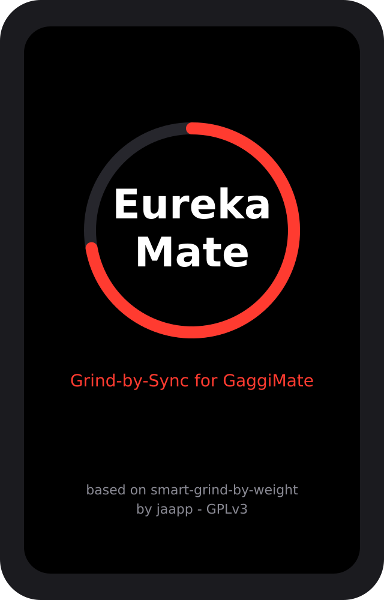</td>
<td width="33%">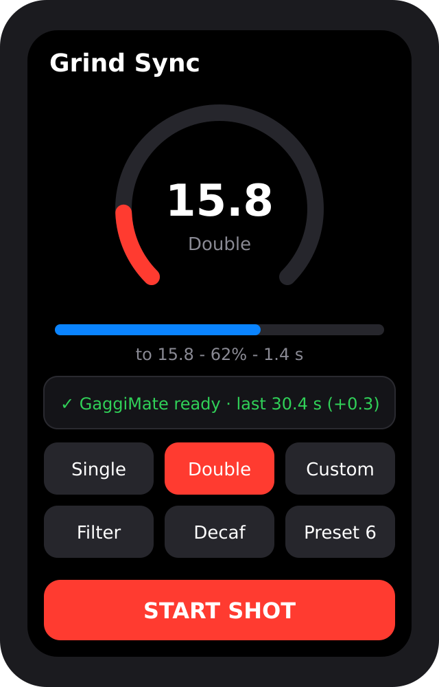</td>
<td width="33%">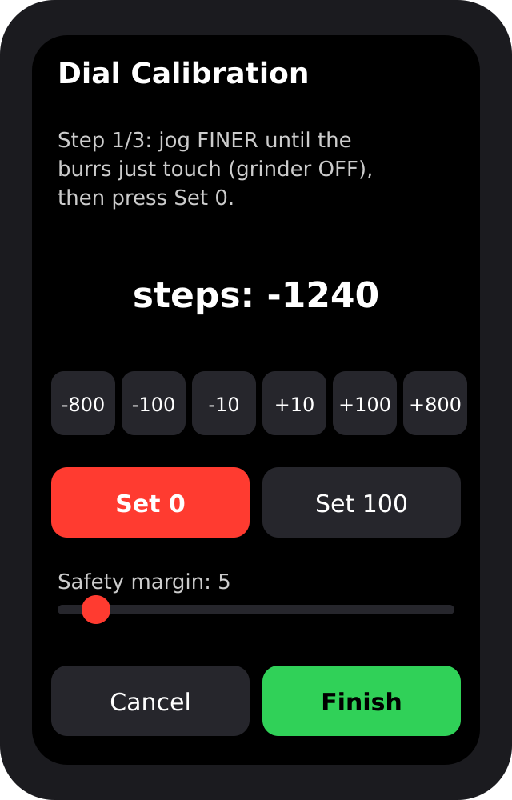</td>
</tr><tr><td colspan="3" align="center"><sub>Display-Mockups (AMOLED 1,64″, an <code>grind_sync_ui.cpp</code> angelehnt, nicht pixelgenau)</sub></td></tr></table>

> ⚠️ **Status: experimentell, noch nicht an einer echten Mühle getestet.** Die Firmware kompiliert,
> die Kernlogik ist mit nativen Unit-Tests abgesichert. In der Mühle liegen **230 V**: vor dem Öffnen
> immer den **Netzstecker ziehen**. Nachbau auf eigene Gefahr (siehe [Haftungsausschluss](#haftungsausschluss)).

---

## Inhalt

1. [Funktionen](#funktionen)
2. [Bilder](#bilder)
3. [Stückliste (BOM)](#stückliste-bom)
4. [Verdrahtung](#verdrahtung)
5. [Mechanik: Motorhalter](#mechanik-motorhalter)
6. [Firmware flashen](#firmware-flashen)
7. [Ersteinrichtung](#ersteinrichtung)
8. [GaggiMate einrichten](#gaggimate-einrichten)
9. [Rezepte](#rezepte)
10. [Regelung erklärt](#regelung-erklärt)
11. [Sicherheit & Verriegelungen](#sicherheit--verriegelungen)
12. [Roadmap](#roadmap)
13. [Dokumentation](#dokumentation)
14. [Lizenz & Credits](#lizenz--credits)
15. [Haftungsausschluss](#haftungsausschluss)

---

## Funktionen

### Grind-by-Sync – Vergleich mit E64 WS + GaggiMate

| E64 WS / GbS-Funktion | EurekaMate |
|---|---|
| Mühle meldet sich bei der Maschine (GaggiMate spielt die „Xenia“) | ✅ Client für `/api/v2/machine`, `/api/v2/mako`, `/api/v2/brewratio`, `/api/v2/scripts/execute` |
| Rezeptplätze, die mit Maschinenprofilen synchronisiert sind (`SYNC_FILTER`) | ✅ 6 Rezepte: 1–3 folgen den Mühlenprofilen, 4–6 sind frei (z. B. Filter, Decaf) |
| Ziel-Getränkegewicht je Rezept (`SYNC_BEVERAGE_WEIGHT`) | ✅ je Rezept oder Dosis × Verhältnis. Die Dosis misst die Waage |
| Bezug an der Mühle starten (Skript 9) | ✅ Taste (GPIO17, auch die Original-Fronttaste), Display, Web oder automatisch nach dem Mahlen |
| Automatische Mahlgradkorrektur aus der Bezugszeit | ✅ Totband, Verstärkung, max. Schritt, Gültigkeitsprüfung |
| GbS an/aus und Zielzeit je Rezept | ✅ |
| „Auto Adjust to Recipe DD“ | ✅ Das Rad fährt beim Rezeptwechsel zum gespeicherten Mahlgrad |
| „GbS start DD“ | ✅ Start-Mahlgrad je Rezept + „Zurücksetzen“ |
| Bezugszeit manuell eingeben | ✅ |
| Bezugsverlauf, Verbindungsstatus | ✅ letzte 20 Bezüge, live auf Display + Web |
| Benutzerpasswort | ✅ optionales Web-Passwort |
| Mehrere Portionen (Filter) | ✅ „Portionen“ je Rezept (1–10) |
| Mahlen nach Gewicht | ✅ von smart-grind-by-weight (±0,03 g Ziel) |

### Motorisiertes Mahlgradrad

- NEMA17 (17HS4401) + TMC2209 am **Zahnrad-Knopf-Kit** (großer Ring + kleiner Alu-Knopf).
- **Kalibrier-Assistent 0/100**: 0 = Scheiben berühren sich, 100 = gröbster Punkt. Sicherheitsabstand über 0, Position in NVS gespeichert.
- **Schnellfahrt** für Rezeptwechsel (Rampe, Boost-Strom, Anfahrt von der groben Seite, langsame Endanfahrt) und **Feinfahrt** für GbS-Korrekturen. Fortschritt + Restzeit.
- Optional: **AS5600**-Encoder (Mehrfachumdrehung, Schlupf, Wiederherstellung nach Boot), **StallGuard**-Blockiererkennung, **Referenzfahrt** (StallGuard oder Endschalter).
- Strom wird **aus der Mühle** genommen (interne ~12-V-Schiene). Wenig Strom, Motor im Stand stromlos, Brown-out-Erkennung. Fallback: externes 12-V-Netzteil.

### Bedienung

- **Display (LVGL)**: EurekaMate-Startbild, Grind-Sync-Seite (Mahlgrad-Bogen, Fahrbalken, Verbindungs-Chip, letzter Bezug, Rezept-Tasten, START SHOT), Kalibrier-Assistent, Netzwerkseite.
- **Weboberfläche** `http://eurekamate.local`:
  - Ersteinrichtung über den Hotspot **`EurekaMate-Setup`** mit Captive Portal
  - WLAN-Suche, GaggiMate per mDNS finden + Verbindungstest
  - Rezepte, Regelung, Motor, Kalibrierung, Verlauf
  - OTA-Update und optionales Passwort
- **Bluetooth**: Gerätename `EurekaMate` (Tools von smart-grind-by-weight).

---

## Bilder

| Web: Status | Web: Rezepte | Web: Mahlgrad / Kalibrierung |
|---|---|---|
| 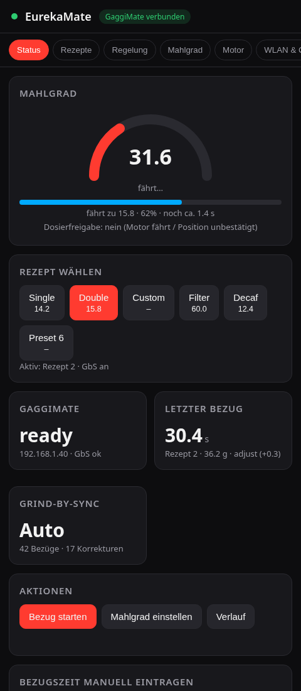 | 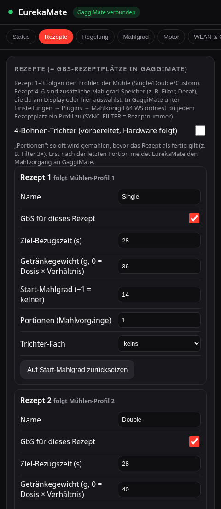 | 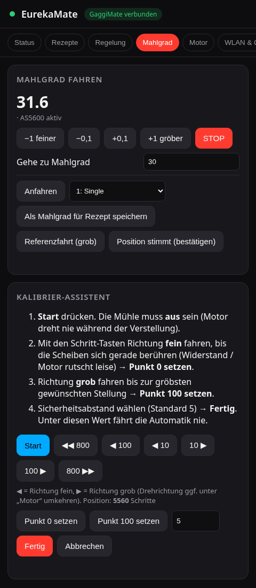 |
| **Web: Motor** | **Web: WLAN & GaggiMate** | **Web: Verlauf** |
| 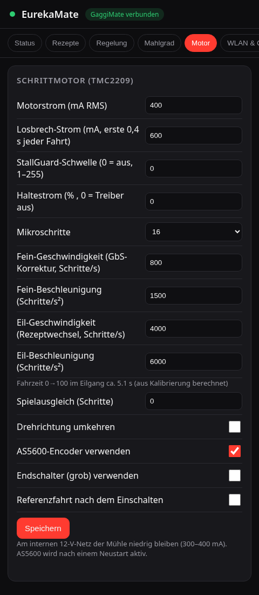 | 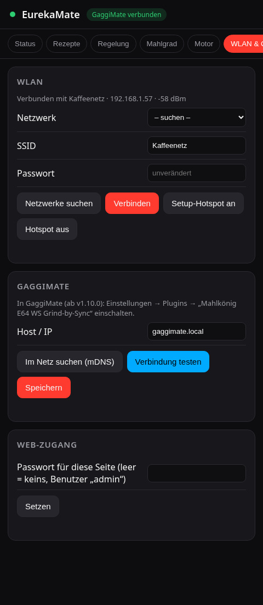 | 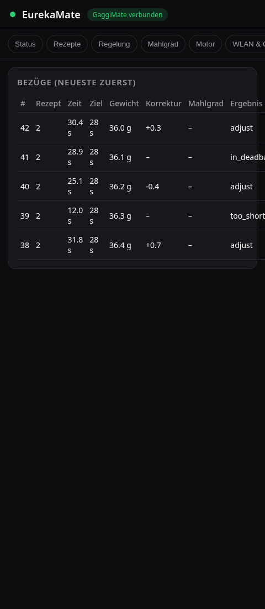 |

<sub>Die Screenshots stammen aus `tools/webui_preview.py` (echte Weboberfläche mit Beispieldaten).</sub>

| Montage (Render) | Motorgehäuse | Seitenhalter | Ritzel |
|---|---|---|---|
| 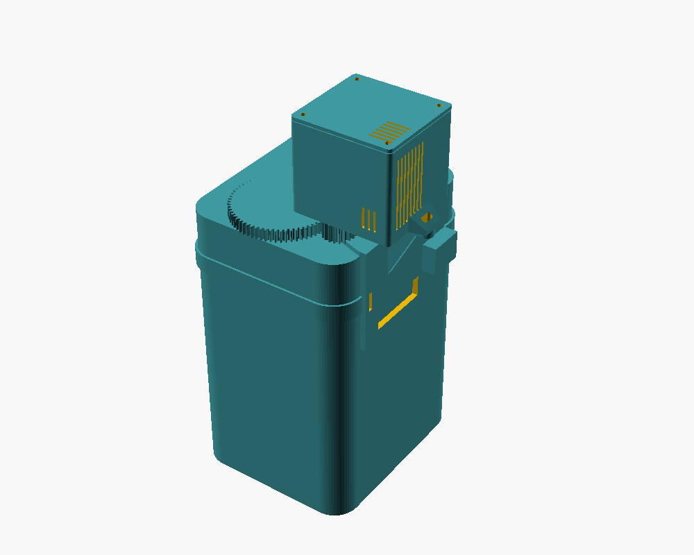 | 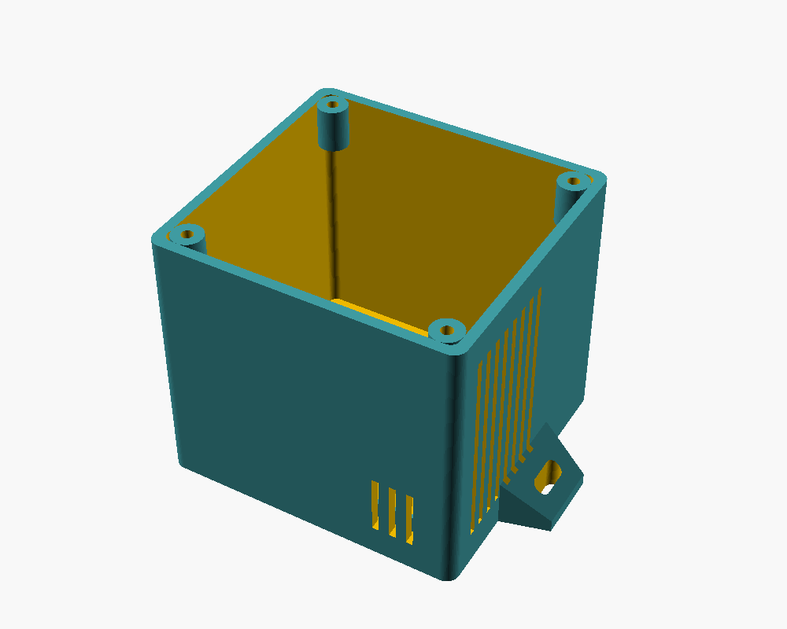 | 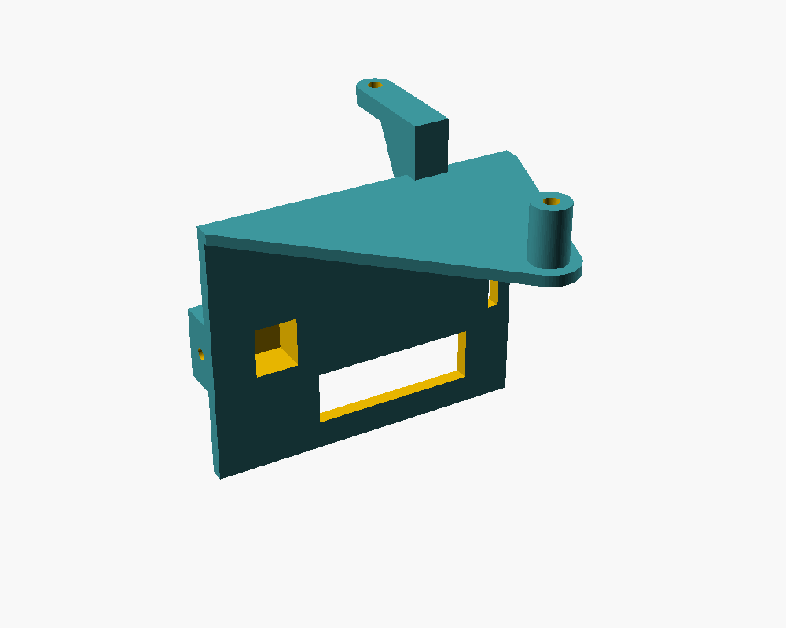 | 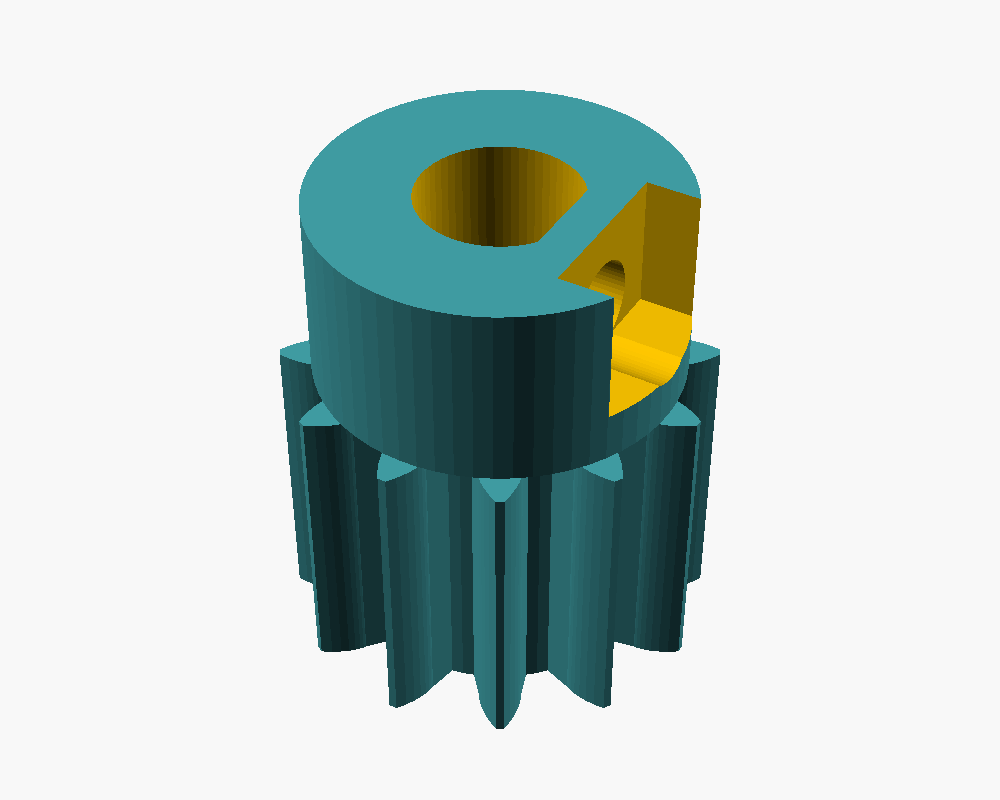 |

---

## Stückliste (BOM)

| Teil | Menge | Bezeichnung / Link | Hinweis |
|---|---|---|---|
| Display + MCU | 1 | [Waveshare ESP32-S3-Touch-AMOLED-1.64](https://www.waveshare.com/wiki/ESP32-S3-Touch-AMOLED-1.64) | wie smart-grind-by-weight |
| Wägezelle + HX711 | 1 | siehe [docs/DOC.md](docs/DOC.md) (Original-Stückliste) | inkl. 3D-Druckteile aus `3d_files/` |
| Schrittmotor | 1 | **17HS4401** NEMA17, ~0,40–0,45 Nm, 1,7 A, 5-mm-D-Welle | mit AS5600: **Doppelwelle**. Pancake-Motoren sind zu schwach |
| Motortreiber | 1 | **TMC2209**-Modul (z. B. [BIGTREETECH TMC2209](https://github.com/bigtreetech/BIGTREETECH-TMC2209-V1.2), FYSETC), [Datenblatt](https://www.analog.com/en/products/tmc2209.html) | mit Kühlkörper |
| Step-Down 5 V | 1 | **MP1584EN** (einstellbar) oder **Mini560** (fest 5 V) | vor dem Anschließen auf 5,0 V einstellen |
| Elko | 1 | 100–470 µF / ≥ 25 V | an TMC2209 VM |
| Elko | 1 | 1000 µF / 10 V | an ESP 5 V (wie im Original) |
| Widerstand | 1 | 1 kΩ | in die UART-Leitung |
| Sicherung | 1 | 1 A träge oder Polyfuse | in die 12-V-Leitung |
| Zahnrad-Knopf-Kit | 1 | Eureka-Mignon-Zahnradknopf (Ring + kleiner Alu-Knopf), z. B. [dieses Kit](https://amzn.eu/d/01fHYqDO) | **Zähnezahl und Modul messen!** |
| Encoder (optional) | 1 | [AS5600](https://ams-osram.com/products/sensor-solutions/position-sensors/ams-as5600-position-sensor)-Platine + Diametral-Magnet 6×2,5 mm | |
| Taster (optional) | 1 | Schließer nach GND | oder Original-Fronttaste |
| Endschalter (optional) | 1 | Mikroschalter | grobes Ende |
| Kleinteile | – | Litze 22 AWG, JST-PH 4-pol., Dupont, Schrumpfschlauch, M3-Schrauben (8/6/10/30 mm), M3-Madenschraube, Gewindeeinsätze | |
| Filament | – | PETG (Gehäuse, Halter, Ritzel), TPU 95A (Spannband) | |
| Fallback (optional) | 1 | Netzteil 12 V / 2 A | falls die 12-V-Schiene einbricht |

Ausführliche Liste mit Preisen und Werkzeug: **[docs/ANLEITUNG_DE.md](docs/ANLEITUNG_DE.md#1-einkaufsliste)** · mit Bildern: **[docs/BAUANLEITUNG.md](docs/BAUANLEITUNG.md#1-was-du-brauchst)**.

---

## Verdrahtung

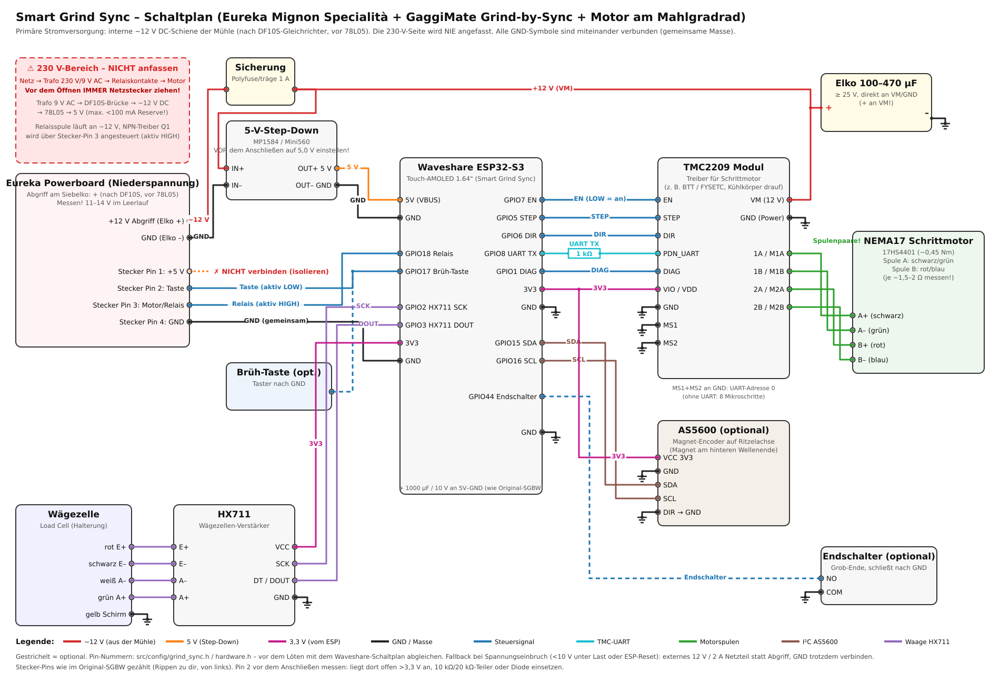

Großansicht: [SVG](docs/img/schaltplan.svg) · Schritt für Schritt: [docs/BAUANLEITUNG.md](docs/BAUANLEITUNG.md#5-kabel-verbinden--eins-nach-dem-anderen) · Tabelle: [docs/ANLEITUNG_DE.md](docs/ANLEITUNG_DE.md#verdrahtungstabelle)

| Funktion | ESP32-S3 GPIO | Gegenstelle |
|---|---|---|
| Strom 5 V | 5V / GND | Step-Down OUT (aus ~12 V der Mühle, nach DF10S, vor 78L05) |
| Mühlenrelais | 18 | Mühlenstecker Pin 3 (aktiv HIGH) |
| Brüh-Taste | 17 | Mühlenstecker Pin 2 / Taster nach GND |
| HX711 SCK / DOUT | 2 / 3 | HX711 |
| TMC2209 STEP / DIR / EN | 5 / 6 / 7 | TMC2209 (EN aktiv LOW) |
| TMC2209 UART | 8 → 1 kΩ → PDN_UART | MS1 = MS2 = GND (Adresse 0) |
| TMC2209 DIAG | 1 | StallGuard |
| AS5600 SDA / SCL | 15 / 16 | optional |
| Endschalter | 44 | optional, nach GND |
| **Mühlenstecker Pin 1 (+5 V)** | **nicht verbinden** | Der 78L05 hat < 100 mA Reserve |

TMC2209 **VM** bekommt die ~12 V über die Sicherung, mit einem 100–470-µF-Elko direkt an VM/GND.
Alle GND sind gemeinsam. **Die 230-V-Seite wird nie angefasst.** Die Pins stehen in
`src/config/grind_sync.h`; vor dem Löten mit dem Waveshare-Schaltplan abgleichen.

---

## Mechanik: Motorhalter

Parametrisches OpenSCAD, **ohne Bohren**. Teile:

- Seitenhalter: wird von unten an die **rechte** Gehäuseseite geschoben.
- Geschlossenes Spannband einmal ums Gehäuse (segmentiert, mit M3 spannbar).
- Geschlossenes Motor- und Elektronikgehäuse am kleinen Knopfzahnrad: TMC2209 mit Lüftungsschlitzen, Step-Down, Elko, AS5600 auf der Ritzelachse, Kabelausgang mit Zugentlastung, verschraubter Deckel, Langlöcher fürs Zahnspiel.
- Ritzel für die 5-mm-D-Welle.

STLs, Vorschaubilder, Maße mit Quellen, Messanleitung und Druckeinstellungen (PETG, 0,2 mm, 4 Wände):
**[hardware/stepper-mount/](hardware/stepper-mount/README.md)**. **Erst messen, dann drucken.**

Drehmoment (Standard 12 → 20 → 66 Zähne, i = 5,5): ca. 0,28 Nm am Rad bei 400 mA und ca. 0,42 Nm bei 600 mA Boost.
Reicht das nicht: kleineres Ritzel, mehr Boost-Strom oder NEMA17 mit Planetengetriebe 5:1
(Details in [docs/GAGGIMATE_GBS.md §7](docs/GAGGIMATE_GBS.md#7-torque-estimate)).

---

## Firmware flashen

### Einfach: Web-Flasher

👉 **https://dobbynator94.github.io/EurekaMate/**

1. Board per **USB-C-Datenkabel** an den PC (Mühle ausgesteckt).
2. Seite in **Chrome oder Edge (Desktop)** öffnen, Version **v0.1.0-beta** wählen, **„Installieren“** klicken.
3. Port wählen, beim ersten Mal **„Erase device“** anhaken, *Install*, 1–2 Minuten warten.

Bilder und Fehlersuche: [BAUANLEITUNG.md, Schritt 8](docs/BAUANLEITUNG.md#8-firmware-flashen-per-web-flasher).
Alle Dateien (App, Bootloader, Partitionen, Komplett-Image, BLE-OTA, Manifest, SHA256) im
[Release v0.1.0-beta](https://github.com/DobbyNator94/EurekaMate/releases/tag/v0.1.0-beta).
Ohne Browser: `esptool --chip esp32s3 write-flash 0x0 eurekamate-v0.1.0-beta-full.bin`.

> Die App liegt im **factory-Slot (0x20000)**, otadata wird geleert. So startet ein frisch geflashtes
> Board immer die neue Firmware. Spätere OTA-Updates gehen wie gewohnt in ota_0/ota_1.

### Für Entwickler: selbst bauen

```bash
git clone https://github.com/DobbyNator94/EurekaMate.git
cd EurekaMate
pip install platformio            # oder VS Code + PlatformIO-Erweiterung
pio run -e waveshare-esp32s3-touch-amoled-164 -t upload
```

- Board wird nicht erkannt: **BOOT** halten, **RESET** tippen, BOOT loslassen, erneut hochladen.
- Spätere Updates ohne Kabel: Weboberfläche → *Update* (`.pio/build/<env>/firmware.bin`) oder per BLE im [Web-Flasher](https://dobbynator94.github.io/EurekaMate/) (Reiter *Update (Bluetooth)*).
- Release bauen: `python3 tools/build_release.py v0.1.0-beta --out ../eurekamate-release --site ../eurekamate-site` (erzeugt Bins, Manifest und die Flasher-Seite für den Branch `gh-pages`).
- Testen ohne Maschine: Umgebung `waveshare-esp32s3-touch-amoled-164-mock` (simuliertes GaggiMate)
  oder `python3 tools/mock_gaggimate.py --port 8080 --auto` und als Host `<PC-IP>:8080` eintragen.
- Unit-Tests: `pio test -e native`.

---

## Ersteinrichtung

1. **Einschalten.** Ohne gespeichertes WLAN startet der Hotspot **`EurekaMate-Setup`**. Das zufällige
   8-stellige Passwort steht am Display unter *Grind Sync → Network*.
2. Mit dem Handy verbinden. Das Captive Portal öffnet sich (sonst `http://192.168.4.1`).
3. **WLAN & GaggiMate** → Netz suchen → speichern. Danach: **http://eurekamate.local**.
4. **GaggiMate finden**: *Suchen (mDNS)* oder IP eintragen → *Verbindung testen* → „GaggiMate Grind-by-Sync OK“.
5. **Kalibrierung 0–100** (Web *Mahlgrad* oder Display *Dial Calibration*), **Mühle aus**:
   1. fein fahren, bis sich die Scheiben berühren → **0 setzen**
   2. zum gröbsten Punkt fahren → **100 setzen**
   3. Sicherheitsabstand wählen (Standard 5) → **Fertig**
6. **Motor** einstellen: Laufstrom 400 mA, Boost 600 mA, Haltestrom 0 %, Richtung prüfen.
7. **12-V-Schiene unter Last messen** (≥ 10 V, kein Reset), sonst externes 12 V / 2 A Netzteil.

---

## GaggiMate einrichten

1. GaggiMate **ab v1.10.0**.
2. Weboberfläche → **Einstellungen → Plugins → „Mahlkönig E64 WS Grind-by-Sync aktivieren“**.
3. Jedem Rezeptplatz (1–6) ein Profil zuordnen. Speichern und neu starten.
4. Im Router GaggiMate eine **feste IP** geben (beide im 2,4-GHz-WLAN).
5. Bei EurekaMate den Host eintragen (`gaggimate.local` oder IP) und testen.

Ablauf: mahlen → EurekaMate sendet `SYNC_FILTER` (= Rezept) + `SYNC_BEVERAGE_WEIGHT` → GaggiMate wählt das
Profil und setzt das Zielgewicht → Bezug (an der Maschine, per Taste oder automatisch) → EurekaMate liest
die Bezugszeit → Mahlgrad wird korrigiert.

---

## Rezepte

| Feld | Bedeutung |
|---|---|
| Name | erscheint auf Display und Web |
| GbS | automatische Korrektur für dieses Rezept an/aus |
| Ziel-Bezugszeit | z. B. 28 s |
| Getränkegewicht | an GaggiMate gemeldet (0 = Dosis × Verhältnis, Standard 2,0) |
| Start-Mahlgrad | Ausgangswert / „Zurücksetzen“ (z. B. Filter = 60) |
| Portionen | wie oft gemahlen wird, bevor das Rezept fertig ist (Filter z. B. 3). GaggiMate wird erst nach der letzten Portion benachrichtigt |
| Trichter-Fach | vorbereitet für den 4-Bohnen-Trichter |

Rezept 1–3 folgen den Profilen der Mühle (Single/Double/Custom), 4–6 sind Zusatzspeicher.
Jedes Rezept merkt sich seinen eigenen, nachgeregelten Mahlgrad. Antippen am Display oder im Web →
Schnellfahrt mit Fortschrittsbalken.

---

## Regelung erklärt

Nach jedem **gültigen** Bezug eines Rezepts mit GbS:

```
Fehler = Bezugszeit − Zielzeit
gültig: 15 s < Bezugszeit ≤ Zielzeit + 15 s, nicht abgebrochen,
        Gewicht höchstens 25 % vom Ziel entfernt
|Fehler| ≤ 1,5 s (Totband)         → keine Änderung
Änderung = 0,3 × (Fehler − Totband), begrenzt auf ±2,0, auf 0,1 gerundet
zu langsam → gröber (+) · zu schnell → feiner (−)
neuer Mahlgrad bleibt zwischen Sicherheitsabstand und 100
```

Beispiel: Ziel 28 s, Bezug 32 s → Fehler +4 s → 0,3 × 2,5 = **+0,8** (gröber). Bezug 28,9 s → im Totband → unverändert.
Im Verlauf steht zu jedem Bezug, warum korrigiert wurde oder nicht (`adjust`, `in_deadband`, `too_short`,
`too_long`, `aborted`, `yield_off`, `disabled`). Alle Werte sind im Reiter *Regelung* einstellbar.

---

## Sicherheit & Verriegelungen

- **Niemals an 230 V arbeiten.** Nur die ~12-V-Schiene nach dem DF10S nutzen. Vor dem Öffnen den Netzstecker ziehen.
- **Mahlmotor nie während einer Radfahrt:**
  - `start_grind()` wird abgelehnt, solange der Schrittmotor fährt oder eine Fahrt wartet.
  - Zusätzlich hält ein harter Haken vor *jedem* Relais-Start (auch Puls/Purge) den Schrittmotor an.
- **Radfahrt nie während des Mahlens:** Vor jedem Schritt wird geprüft, ob die Mühle läuft.
- **Dosierfreigabe `dose_allowed`** (für den künftigen Trichter): Sie ist nur wahr, wenn
  - die Fahrt **abgeschlossen** ist (keine Fahrt läuft oder wartet),
  - die Position **bestätigt** ist (kalibriert, vertrauenswürdig, keine Kalibrierung, kein Stall).

  Eine Dosierklappe darf erst dann Bohnen zum Mahlwerk lassen. Sichtbar im Web-Status und über die API.
- **Softlimits**: nie unter den Sicherheitsabstand über 0 (Scheiben berühren sich). Unkalibrierte Fahrten sind begrenzt.
- **Brown-out / Reset während einer Fahrt** → Position gilt als unsicher, bis Referenzfahrt, Bestätigung oder AS5600-Wiederherstellung.
- **StallGuard** (optional): Blockieren → Stopp + Fehlermeldung.
- Keine Zugangsdaten im Repository: WLAN und Passwort liegen nur im NVS des Geräts.

---

## Roadmap

- [ ] Erster Hardwaretest an der Specialità: 12-V-Schiene, Drehmoment, Zahnspiel, StallGuard-Werte
- [ ] Maße des Zahnrad-Kits und der Knopfposition einmessen und Standardwerte im OpenSCAD aktualisieren
- [ ] **4-Bohnen-Trichter mit Dosierkammern**:
  - 4 Kammern mit je einem Fachsensor; das Fach wählt das Rezept (Datenmodell, `SYNC_HOPPER_SENSOR_PINS` und Haken sind schon vorhanden)
  - Dosierklappe/-schnecke je Kammer, freigegeben nur bei `dose_allowed`
  - Einzeldosierung je Portion (Filter = mehrere Dosierungen)
- [ ] Live-Status per WebSocket/SSE statt Polling
- [ ] TMC2209-UART lesend (Diagnose, Temperaturwarnung)
- [x] Web-Flasher mit EurekaMate-Releases ([Link](https://dobbynator94.github.io/EurekaMate/))

---

## Dokumentation

| Dokument | Inhalt |
|---|---|
| [docs/BAUANLEITUNG.md](docs/BAUANLEITUNG.md) · 🇬🇧 [BUILD_GUIDE_EN.md](docs/BUILD_GUIDE_EN.md) | 🧸 Ganz einfache Schritt-für-Schritt-Anleitung, ein Bild pro Schritt, inkl. Web-Flasher |
| [docs/ANLEITUNG_DE.md](docs/ANLEITUNG_DE.md) · 🇬🇧 [ANLEITUNG_EN.md](docs/ANLEITUNG_EN.md) | Ausführliche Anleitung: Einkaufsliste, Werkzeug, Verdrahtungstabelle, Messen, Löten, Flashen, Assistent, Fehlersuche |
| [Web-Flasher](https://dobbynator94.github.io/EurekaMate/) · [Release v0.1.0-beta](https://github.com/DobbyNator94/EurekaMate/releases/tag/v0.1.0-beta) | Firmware installieren / herunterladen |
| [docs/GAGGIMATE_GBS.md](docs/GAGGIMATE_GBS.md) | Protokoll, Regelung, Strom, Drehmoment, StallGuard, Fahrzeiten, Pins (Englisch) |
| [hardware/stepper-mount/README.md](hardware/stepper-mount/README.md) | Motorhalter: STL, Maße, Quellen, Druck, Montage |
| [docs/img/schaltplan.png](docs/img/schaltplan.png) | Schaltplan (erzeugt mit `tools/gen_schematic.py`) |
| [docs/DOC.md](docs/DOC.md), [docs/UPSTREAM_README.md](docs/UPSTREAM_README.md) | Original-Doku von smart-grind-by-weight (Waage, Display, BLE-Tools) |

> 🌍 Regel: Jedes deutsche Dokument hat eine englische Version, und beide werden gemeinsam aktuell gehalten.

---

## Lizenz & Credits

- **Basis:** [jaapp/smart-grind-by-weight](https://github.com/jaapp/smart-grind-by-weight). Grind-by-Weight-Firmware, UI, Waage, 3D-Teile, BLE-Tools. Danke, jaapp!
- **Software:** GPLv3 ([LICENSE](LICENSE)), wie im Original.
- **Hardware** (3D-Teile, OpenSCAD, Schaltplan): CERN-OHL-S v2, wie im Original.
- **GaggiMate** ([jniebuhr/gaggimate](https://github.com/jniebuhr/gaggimate), CC BY-NC-SA 4.0) ist **nicht** Teil dieses Repos. Es wird kein GaggiMate-Code verwendet; der Grind-by-Sync-Client wurde nach dem beobachtbaren HTTP-Verhalten selbst geschrieben.
- Mahlkönig, E64 WS, Grind-by-Sync und Xenia sind Marken ihrer Inhaber. Eureka und Mignon sind Marken von Eureka/Conti Valerio. EurekaMate steht mit keinem dieser Unternehmen in Verbindung.
- Repo-Hinweis: Der Ordner `.github/workflows` des Originals wurde beim Import aus der Historie entfernt (dem Push-Token fehlte der `workflow`-Scope).

## Haftungsausschluss

Dies ist ein privates Bastelprojekt **ohne jede Gewährleistung**. Ein Umbau kann die Garantie der Mühle
beenden. Arbeiten in Geräten mit Netzspannung sind **lebensgefährlich**: Netzstecker ziehen, nur im
Niederspannungsteil arbeiten, im Zweifel eine Elektrofachkraft fragen. Ein falsch kalibrierter Motor
kann die Mahlscheiben aufeinander fahren. Kalibriere sorgfältig und halte den Sicherheitsabstand ein.
Nutzung auf eigene Gefahr.
