# EurekaMate ☕⚙️

> [!CAUTION]
> **🇩🇪 ACHTUNG – BITTE ZUERST LESEN:** Dieses Projekt ist **komplett „vibe-coded“ (KI-generiert)** und
> **komplett ungetestet** – weder die Firmware noch die Hardware, die Pläne oder die Anleitungen wurden an einer
> echten Mühle ausprobiert. Es gibt **keinerlei Garantie, Gewährleistung oder Haftung für irgendetwas**.
> **Jeder ist allein für sich selbst verantwortlich.** Arbeiten an **230-V-Geräten ist gefährlich** und kann
> tödlich sein. **Wenn du nicht genau weißt, was du tust, lass es lieber ganz bleiben.**
>
> **🇬🇧 WARNING – READ THIS FIRST:** This project is **entirely vibe-coded (AI-generated)** and **completely
> untested** – none of the firmware, hardware, schematics or guides have been tried on a real grinder. There is
> **no guarantee, warranty or liability for anything whatsoever**. **Everyone is solely responsible for
> themselves.** Working on **230 V devices is dangerous** and can kill you. **If you don't know exactly what
> you're doing, better don't do anything at all.**

**Eureka Mignon Specialità + GaggiMate Grind-by-Sync + motorized grind dial**

🇩🇪 Deutsche Version: **[README.md](README.md)**

| 🧸 **[Step-by-step build guide (with images)](docs/BUILD_GUIDE_EN.md)** | ⚡ **[Web flasher](https://dobbynator94.github.io/EurekaMate/)** | 📦 **[Release v0.1.0-beta](https://github.com/DobbyNator94/EurekaMate/releases/tag/v0.1.0-beta)** | 🛒 **[Shopping list (DE/EU)](docs/SHOPPING_LIST_EN.md)** |
|:---:|:---:|:---:|:---:|
| For beginners: 11 steps, one image per step | Install the firmware in your browser (Chrome/Edge + USB-C) | Pre-release, **untested on hardware** | Cheapest Amazon/eBay sources incl. shipping, as of 26 Nov 2026 |

EurekaMate turns a Eureka Mignon Specialità into a grinder that works with
[GaggiMate](https://github.com/jniebuhr/gaggimate) the way a **Mahlkönig E64 WS** works with
**Grind-by-Sync (GbS)**:

- It grinds to a tenth of a gram.
- It reports every grind to GaggiMate: the recipe and the target beverage weight.
- It can start the shot.
- After the shot, **a stepper motor corrects the grind setting** based on the shot time.

Switching between recipes (e.g. *Filter 60 → Decaf*) takes a few seconds.

EurekaMate is built on **[smart-grind-by-weight](https://github.com/jaapp/smart-grind-by-weight) by jaapp**.
Grind-by-weight, the touch UI, the scale and the BLE tools come from there. Many thanks!

<table><tr>
<td width="33%">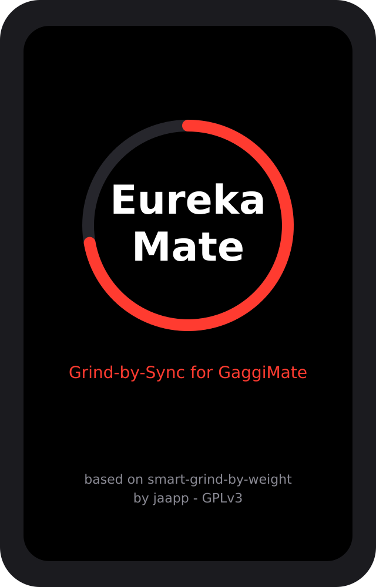</td>
<td width="33%">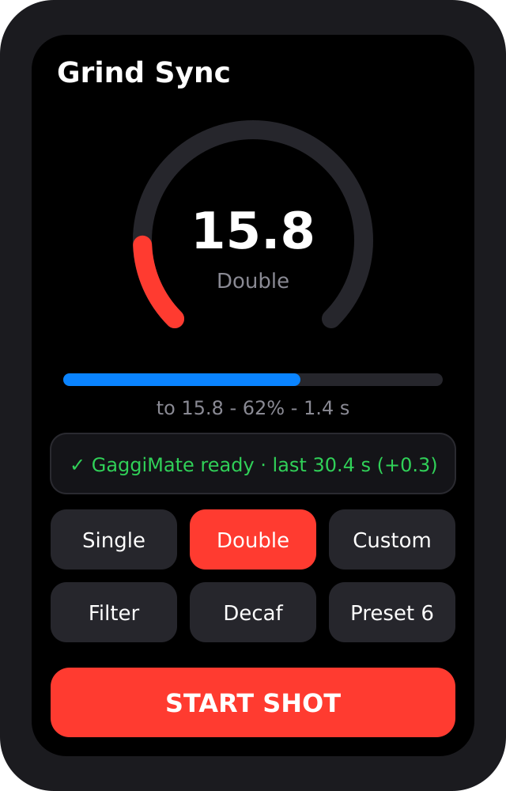</td>
<td width="33%">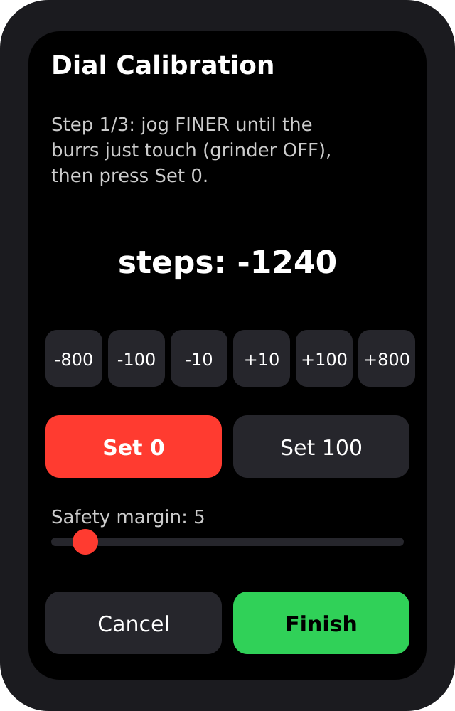</td>
</tr><tr><td colspan="3" align="center"><sub>Display mockups (1.64″ AMOLED, based on <code>grind_sync_ui.cpp</code>, not pixel-exact)</sub></td></tr></table>

> ⚠️ **Status: experimental, not yet tested on a real grinder.** The firmware builds and the core
> logic has native unit tests. The grinder contains **230 V**: always **unplug it** before opening.
> Build at your own risk (see [Disclaimer](#disclaimer)).

---

## Features

### Grind-by-Sync parity with E64 WS + GaggiMate

| E64 WS / GbS feature | EurekaMate |
|---|---|
| Grinder talks to the machine (GaggiMate plays the "Xenia") | ✅ Client for `/api/v2/machine`, `/api/v2/mako`, `/api/v2/brewratio`, `/api/v2/scripts/execute` |
| Recipe slots synced with machine profiles (`SYNC_FILTER`) | ✅ 6 recipes: 1–3 follow the grinder profiles, 4–6 are free (e.g. Filter, Decaf) |
| Beverage weight per recipe (`SYNC_BEVERAGE_WEIGHT`) | ✅ Per recipe or dose × ratio. The dose is measured by the scale |
| Start the shot from the grinder (script 9) | ✅ Button (GPIO17, also the original front button), display, web, or automatically after grinding |
| Automatic grind correction from the shot time | ✅ Deadband, gain, max step, validity checks |
| GbS on/off and target time per recipe | ✅ |
| "Auto Adjust to Recipe DD" | ✅ The dial travels to the stored setting when the recipe changes |
| "GbS start DD" | ✅ Start setting per recipe + reset |
| Manual brew-time entry | ✅ |
| Shot history, connection status | ✅ Last 20 shots, live on display + web |
| User password | ✅ Optional web password |
| Multiple portions (filter) | ✅ "Portions" per recipe (1–10) |
| Grind by weight | ✅ From smart-grind-by-weight (±0.03 g target) |

### Motorized dial

- NEMA17 (17HS4401) + TMC2209 on the **gear-knob kit** (big ring + small aluminium knob).
- **Calibration wizard 0/100**: 0 = burrs touching, 100 = coarsest point. Safety margin above 0; position stored in NVS.
- **Fast travel** for recipe changes (ramp, boost current, approach from the coarse side, slow final approach) and **fine travel** for GbS corrections. Progress + ETA.
- Optional: **AS5600** encoder (multi-turn, slip check, boot recovery), **StallGuard** stall detection, **homing** (StallGuard or endstop).
- Powered **from the grinder** (internal ~12 V rail): low currents, driver off when idle, brown-out detection. Fallback: external 12 V supply.

### User interface

- **Display (LVGL)**:
  - EurekaMate splash
  - Grind Sync page: setting arc, travel bar, connection chip, last shot, recipe buttons, START SHOT
  - Calibration wizard and network page
- **Web UI** at `http://eurekamate.local`:
  - First setup through the **`EurekaMate-Setup`** hotspot with a captive portal
  - WiFi scan, GaggiMate mDNS discovery + connection test
  - Recipes, regulation, motor, calibration, history
  - OTA update and an optional password
- **Bluetooth**: device name `EurekaMate` (smart-grind-by-weight tools).

---

## Images

| Web: Status | Web: Recipes | Web: Dial / calibration |
|---|---|---|
| 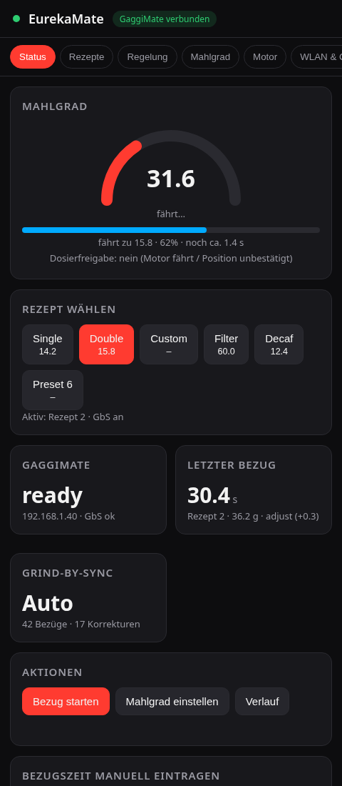 | 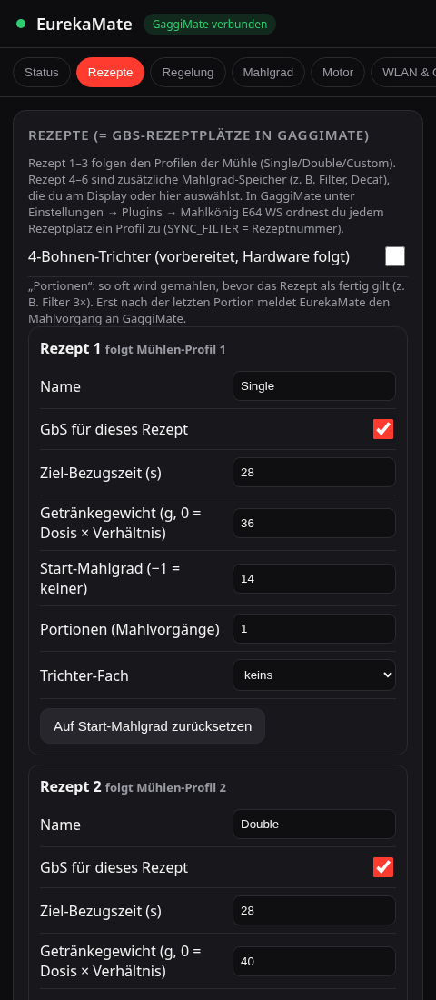 | 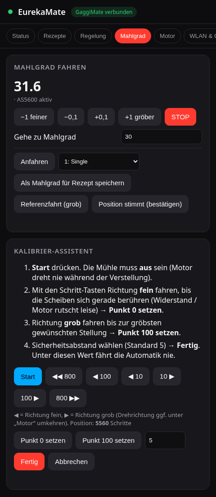 |
| **Web: Motor** | **Web: WiFi & GaggiMate** | **Web: History** |
| 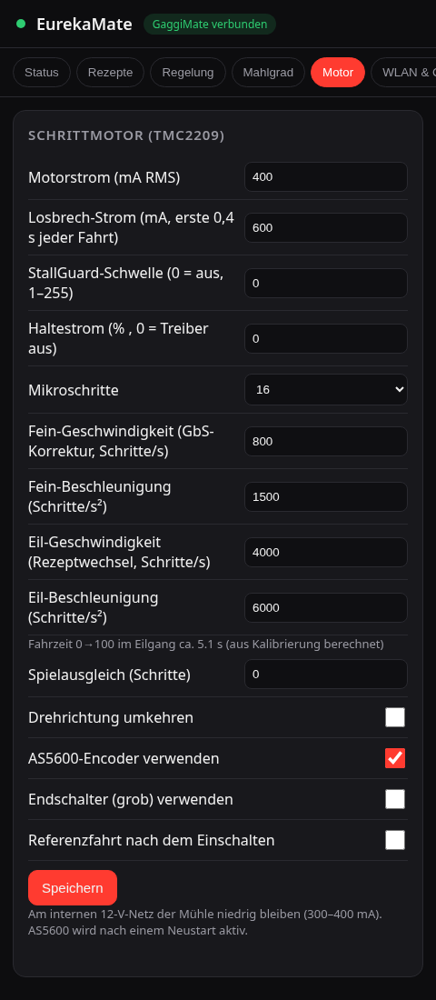 | 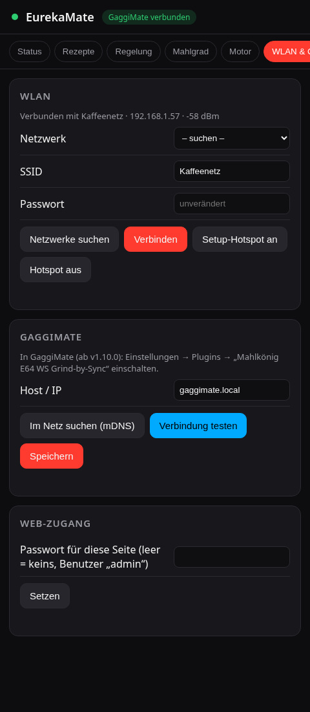 | 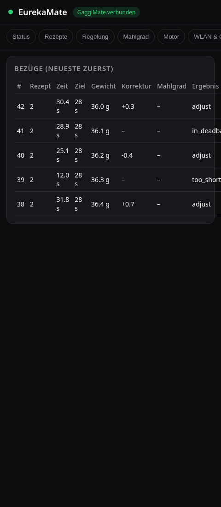 |

<sub>Screenshots from `tools/webui_preview.py` (the real web UI with sample data; the UI language is German).</sub>

| Assembly (render) | Motor housing | Side brace | Pinion |
|---|---|---|---|
| 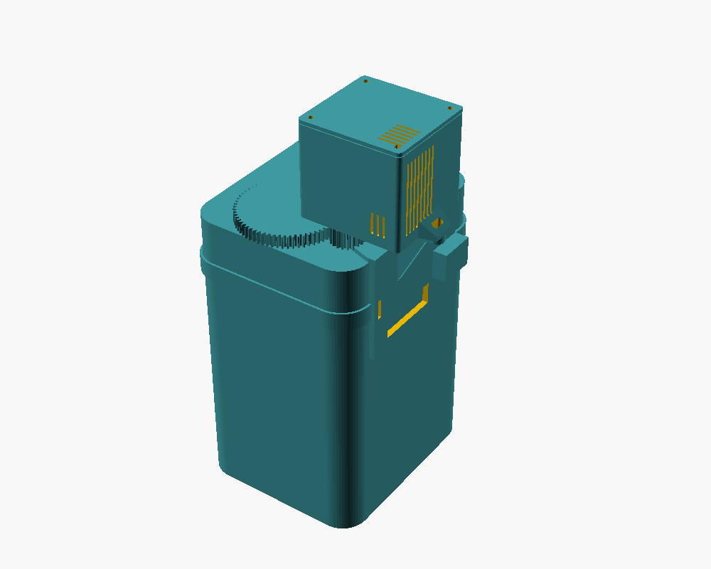 | 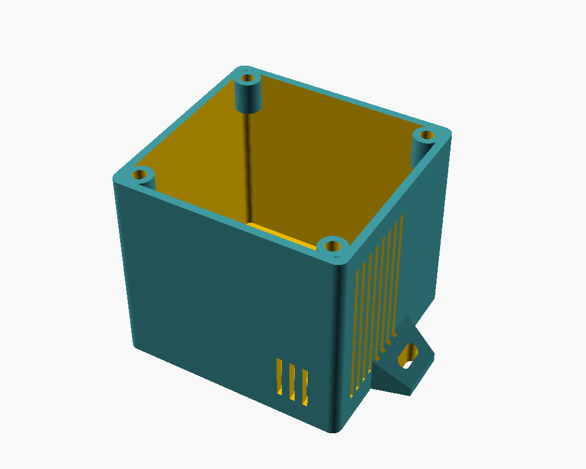 | 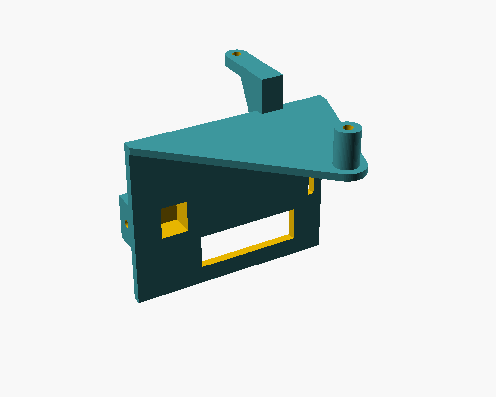 | 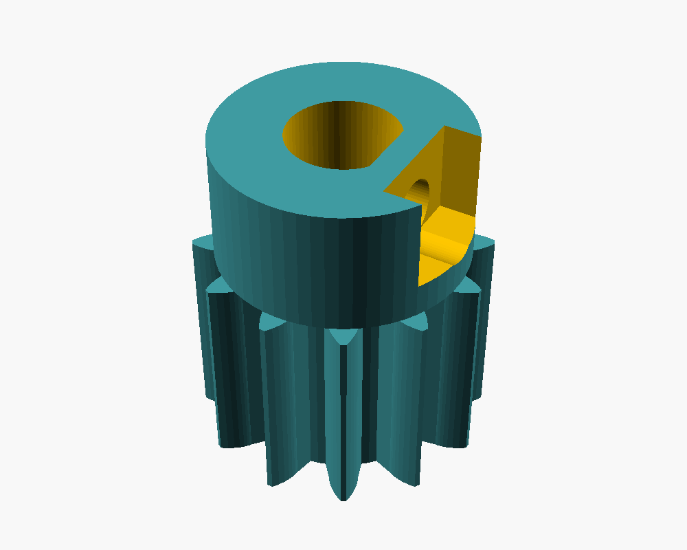 |

---

## Bill of materials

| Part | Qty | Name / link | Note |
|---|---|---|---|
| Display + MCU | 1 | [Waveshare ESP32-S3-Touch-AMOLED-1.64](https://www.waveshare.com/wiki/ESP32-S3-Touch-AMOLED-1.64) | same as smart-grind-by-weight |
| Load cell + HX711 | 1 | see [docs/DOC.md](docs/DOC.md) (original BOM) | incl. printed parts from `3d_files/` |
| Stepper | 1 | **17HS4401** NEMA17, ~0.40–0.45 Nm, 1.7 A, 5 mm D-shaft | **dual shaft** if you use the AS5600. Pancake motors are too weak |
| Driver | 1 | **TMC2209** module (e.g. [BIGTREETECH](https://github.com/bigtreetech/BIGTREETECH-TMC2209-V1.2), FYSETC), [datasheet](https://www.analog.com/en/products/tmc2209.html) | with heatsink |
| 5 V buck | 1 | **MP1584EN** (adjustable) or **Mini560** (fixed 5 V) | set to 5.0 V before connecting |
| Capacitor | 1 | 100–470 µF / ≥ 25 V | at TMC2209 VM |
| Capacitor | 1 | 1000 µF / 10 V | at ESP 5 V (as in the original) |
| Resistor | 1 | 1 kΩ | in the UART line |
| Fuse | 1 | 1 A slow-blow or polyfuse | in the 12 V line |
| Gear-knob kit | 1 | Eureka Mignon gear knob (ring + small aluminium knob), e.g. [this kit](https://amzn.eu/d/01fHYqDO) | **measure tooth counts and module!** |
| Encoder (optional) | 1 | [AS5600](https://ams-osram.com/products/sensor-solutions/position-sensors/ams-as5600-position-sensor) board + 6×2.5 mm diametric magnet | |
| Button (optional) | 1 | Normally open, to GND | or the original front button |
| Endstop (optional) | 1 | Microswitch | coarse end |
| Small parts | – | 22 AWG wire, 4-pin JST-PH, Dupont, heat shrink, M3 screws (6/8/10/30 mm), M3 grub screw, 6× M3×5.7 heat-set inserts | |
| Filament | – | PETG (housing, brace, pinion), TPU 95A (strap) | |
| Fallback (optional) | 1 | 12 V / 2 A power supply | if the 12 V rail sags |

🛒 **Shopping list with verified links, shipping and totals: [docs/SHOPPING_LIST_EN.md](docs/SHOPPING_LIST_EN.md)** (🇩🇪 [EINKAUFSLISTE_DE.md](docs/EINKAUFSLISTE_DE.md)) · Full list with tools: **[docs/ANLEITUNG_EN.md](docs/ANLEITUNG_EN.md#1-shopping-list)** · with pictures: **[docs/BUILD_GUIDE_EN.md](docs/BUILD_GUIDE_EN.md#1-what-you-need)**.

---

## Wiring

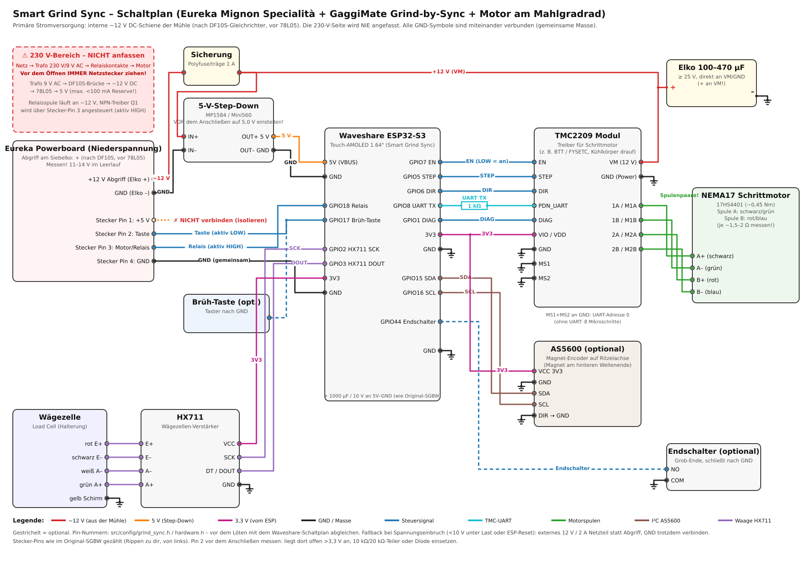

Full size: [SVG](docs/img/schaltplan.svg). Step by step: [docs/BUILD_GUIDE_EN.md](docs/BUILD_GUIDE_EN.md#5-connect-the-wires--one-at-a-time) · wiring table: [docs/ANLEITUNG_EN.md](docs/ANLEITUNG_EN.md#wiring-table).

| Function | ESP32-S3 GPIO | Connects to |
|---|---|---|
| 5 V power | 5V / GND | Buck output (fed from the grinder's ~12 V, after the DF10S, before the 78L05) |
| Grinder relay | 18 | Grinder plug pin 3 (active HIGH) |
| Brew button | 17 | Grinder plug pin 2 / button to GND |
| HX711 SCK / DOUT | 2 / 3 | HX711 |
| TMC2209 STEP / DIR / EN | 5 / 6 / 7 | TMC2209 (EN active LOW) |
| TMC2209 UART | 8 → 1 kΩ → PDN_UART | MS1 = MS2 = GND (address 0) |
| TMC2209 DIAG | 1 | StallGuard |
| AS5600 SDA / SCL | 15 / 16 | optional |
| Endstop | 44 | optional, to GND |
| **Grinder plug pin 1 (+5 V)** | **do not connect** | The 78L05 has < 100 mA headroom |

TMC2209 **VM** gets the ~12 V through the fuse, with a 100–470 µF capacitor directly at VM/GND.
All grounds are common. **Never touch the 230 V side.** Pins are defined in
`src/config/grind_sync.h`; check them against the Waveshare schematic before soldering.

---

## Mechanics: motor mount

Parametric OpenSCAD, **no drilling**. Parts:

- Side brace that slides onto the **right** side from below.
- Closed strap around the body (segmented, tensioned with an M3 screw).
- Enclosed motor and electronics housing at the small knob gear: TMC2209 with vents, buck, capacitor, AS5600 on the pinion axis, cable exit with strain relief, screwed lid, slots for gear-mesh adjustment.
- Pinion for the 5 mm D-shaft.

STLs, previews, dimensions with sources, how to measure and print settings (PETG, 0.2 mm, 4 walls):
**[hardware/stepper-mount/](hardware/stepper-mount/README.md)**. **Measure first, then print.**

Torque (default 12 → 20 → 66 teeth, i = 5.5): about 0.28 Nm at the dial at 400 mA, and about 0.42 Nm at 600 mA boost.
If that is not enough: a smaller pinion, more boost current, or a NEMA17 with a 5:1 planetary gearbox
([docs/GAGGIMATE_GBS.md §7](docs/GAGGIMATE_GBS.md#7-torque-estimate)).

---

## Flashing

### Easy: web flasher

👉 **https://dobbynator94.github.io/EurekaMate/**

1. Connect the board with a **USB-C data cable** (grinder unplugged).
2. Open the page in **Chrome or Edge (desktop)**, choose **v0.1.0-beta**, click **“Install”**.
3. Pick the port, tick **“Erase device”** the first time, *Install*, wait 1–2 minutes.

Images and troubleshooting: [BUILD_GUIDE_EN.md, step 8](docs/BUILD_GUIDE_EN.md#8-flash-the-firmware-with-the-web-flasher).
All files (app, bootloader, partitions, full image, BLE OTA, manifest, SHA256) are in
[release v0.1.0-beta](https://github.com/DobbyNator94/EurekaMate/releases/tag/v0.1.0-beta).
Without a browser: `esptool --chip esp32s3 write-flash 0x0 eurekamate-v0.1.0-beta-full.bin`.

> The app goes into the **factory slot (0x20000)** and otadata is cleared, so a freshly flashed board
> always boots the new firmware. Later OTA updates use ota_0/ota_1 as usual.

### For developers: build it yourself

```bash
git clone https://github.com/DobbyNator94/EurekaMate.git
cd EurekaMate
pip install platformio            # or VS Code + PlatformIO extension
pio run -e waveshare-esp32s3-touch-amoled-164 -t upload
```

- Board not detected: hold **BOOT**, tap **RESET**, release BOOT, upload again.
- Later updates without a cable: web UI → *Update* (`.pio/build/<env>/firmware.bin`) or over BLE in the [web flasher](https://dobbynator94.github.io/EurekaMate/) (*Update (Bluetooth)* tab).
- Build a release: `python3 tools/build_release.py v0.1.0-beta --out ../eurekamate-release --site ../eurekamate-site` (creates the bins, manifest and the flasher site for the `gh-pages` branch).
- Testing without a machine:
  - the `waveshare-esp32s3-touch-amoled-164-mock` env (simulated GaggiMate), or
  - `python3 tools/mock_gaggimate.py --port 8080 --auto`, with `<PC-IP>:8080` as the host.
- Unit tests: `pio test -e native`.

---

## First setup

1. **Power on.** With no WiFi stored, the **`EurekaMate-Setup`** hotspot starts. Its random 8-digit password is shown on the display under *Grind Sync → Network*.
2. Connect with your phone. The captive portal opens (otherwise go to `http://192.168.4.1`).
3. **WLAN & GaggiMate** tab → scan → save. After that the device is at **http://eurekamate.local**.
4. **Find GaggiMate**: *Suchen (mDNS)* or enter the IP → *Verbindung testen* → "GaggiMate Grind-by-Sync OK".
5. **Calibrate 0–100** (web *Mahlgrad* or display *Dial Calibration*), with the **grinder off**:
   1. Jog finer until the burrs just touch → **Set 0**.
   2. Jog to the coarsest point → **Set 100**.
   3. Choose the safety margin (default 5) → **Finish**.
6. **Motor**: run current 400 mA, boost 600 mA, hold current 0 %. Check the direction.
7. **Measure the 12 V rail under load**: it must stay ≥ 10 V with no reset. Otherwise use an external 12 V / 2 A supply.

---

## GaggiMate setup

1. GaggiMate **v1.10.0 or newer**.
2. Web UI → **Settings → Plugins → "Enable Mahlkönig E64 WS Grind-by-Sync"**.
3. Map a profile to each recipe slot (1–6). Save and restart.
4. Give GaggiMate a **fixed IP** in your router (both devices on 2.4 GHz WiFi).
5. In EurekaMate, enter the host (`gaggimate.local` or the IP) and test.

Flow:

1. You grind. EurekaMate sends `SYNC_FILTER` (= recipe) and `SYNC_BEVERAGE_WEIGHT`.
2. GaggiMate selects the profile and sets the target weight.
3. The shot starts: at the machine, by button, or automatically.
4. EurekaMate reads the shot time and corrects the grind.

---

## Recipes

| Field | Meaning |
|---|---|
| Name | Shown on display and web |
| GbS | Automatic correction for this recipe on/off |
| Target time | e.g. 28 s |
| Beverage weight | Reported to GaggiMate (0 = dose × ratio, default 2.0) |
| Start setting | Starting value and reset target (e.g. Filter = 60) |
| Portions | Number of grinds before the recipe counts as done (filter e.g. 3). GaggiMate is notified after the last portion |
| Hopper slot | Reserved for the 4-bean hopper |

Recipes 1–3 follow the grinder profiles (Single/Double/Custom); 4–6 are extra presets. Each recipe
keeps its own corrected setting. Tap a recipe on the display or in the web UI and the dial travels
there on the fast profile, with a progress bar.

---

## Regulation explained

After every **valid** shot of a recipe with GbS on:

```
error = shot time − target time
valid: 15 s < shot time ≤ target + 15 s, not aborted,
       weight within 25 % of target
|error| ≤ 1.5 s (deadband)          → no change
delta = 0.3 × (error − deadband), clamped to ±2.0, rounded to 0.1
too slow → coarser (+) · too fast → finer (−)
the new setting stays between the safety margin and 100
```

Examples (target 28 s):

- Shot 32 s → error +4 s → 0.3 × 2.5 = **+0.8** (coarser).
- Shot 28.9 s → inside the deadband → no change.

The history shows why each shot was or was not used: `adjust`, `in_deadband`, `too_short`,
`too_long`, `aborted`, `yield_off` or `disabled`. All values are adjustable in the *Regelung* tab.

---

## Safety & interlocks

- **Never work on 230 V.** Only use the ~12 V rail after the DF10S. Unplug before opening.
- **The grinder motor never runs during a dial move:**
  - `start_grind()` is refused while the stepper moves or has a move queued.
  - A hard hook before *every* relay start (including pulses and purge) also stops the stepper.
- **The dial never moves while grinding:** a busy check runs before every step.
- **`dose_allowed` interlock** (for the future hopper) is true only when:
  - the move is **complete** (nothing moving or queued), and
  - the position is **confirmed** (calibrated, trusted, not calibrating, no stall).

  A dosing gate may release beans to the burrs only then. It is visible in the web status and the API.
- **Soft limits**: the dial never goes below the safety margin above 0 (burrs touching). Uncalibrated jogs are limited.
- **Brown-out or reset mid-move**: the position is marked untrusted until you home, confirm it, or the AS5600 recovers it.
- **StallGuard** (optional): a stall stops the motor and shows an error.
- No credentials in the repository: WiFi and password live only in the device's NVS.

---

## Roadmap

- [ ] First hardware test on the Specialità: 12 V rail, torque, gear mesh, StallGuard values
- [ ] Measure the gear kit and knob position, then update the OpenSCAD defaults
- [ ] **4-bean hopper with dosing chambers**:
  - 4 chambers, each with a slot sensor. The slot selects the recipe; the data model, `SYNC_HOPPER_SENSOR_PINS` and hooks already exist.
  - A dosing gate or auger per chamber, released only when `dose_allowed` is true.
  - Single dosing per portion (filter = several doses).
- [ ] Live status over WebSocket/SSE instead of polling
- [ ] TMC2209 UART readback (diagnostics, temperature warnings)
- [x] Web flasher with EurekaMate releases ([link](https://dobbynator94.github.io/EurekaMate/))

---

## Documentation

| Document | Content |
|---|---|
| [docs/BUILD_GUIDE_EN.md](docs/BUILD_GUIDE_EN.md) · 🇩🇪 [BAUANLEITUNG.md](docs/BAUANLEITUNG.md) | 🧸 Very simple step-by-step guide, one image per step, incl. web flasher |
| [docs/SHOPPING_LIST_EN.md](docs/SHOPPING_LIST_EN.md) · 🇩🇪 [EINKAUFSLISTE_DE.md](docs/EINKAUFSLISTE_DE.md) | 🛒 Shopping list (Germany/EU): cheapest Amazon Prime/eBay sources, shipping, totals, screw checklist |
| [docs/ANLEITUNG_EN.md](docs/ANLEITUNG_EN.md) · 🇩🇪 [ANLEITUNG_DE.md](docs/ANLEITUNG_DE.md) | Detailed guide: shopping list, tools, wiring table, measuring, soldering, flashing, wizard, troubleshooting |
| [Web flasher](https://dobbynator94.github.io/EurekaMate/) · [Release v0.1.0-beta](https://github.com/DobbyNator94/EurekaMate/releases/tag/v0.1.0-beta) | Install / download the firmware |
| [docs/GAGGIMATE_GBS.md](docs/GAGGIMATE_GBS.md) | Protocol, regulation, power, torque, StallGuard, travel times, pins |
| [hardware/stepper-mount/README.md](hardware/stepper-mount/README.md) | Motor mount: STL, dimensions, sources, printing, assembly |
| [docs/img/schaltplan.png](docs/img/schaltplan.png) | Schematic (generated by `tools/gen_schematic.py`) |
| [docs/DOC.md](docs/DOC.md), [docs/UPSTREAM_README.md](docs/UPSTREAM_README.md) | Original smart-grind-by-weight docs (scale, display, BLE tools) |

> 🌍 Rule: every German document has an English version, and both are kept in sync.

---

## License & credits

- **Based on** [jaapp/smart-grind-by-weight](https://github.com/jaapp/smart-grind-by-weight): grind-by-weight firmware, UI, scale, 3D parts, BLE tools. Thank you, jaapp!
- **Software:** GPLv3 ([LICENSE](LICENSE)), as upstream.
- **Hardware** (3D parts, OpenSCAD, schematic): CERN-OHL-S v2, as upstream.
- **GaggiMate** ([jniebuhr/gaggimate](https://github.com/jniebuhr/gaggimate), CC BY-NC-SA 4.0) is **not** part of this repository. No GaggiMate code is used; the Grind-by-Sync client is written independently from the observable HTTP behaviour.
- Mahlkönig, E64 WS, Grind-by-Sync and Xenia are trademarks of their owners. Eureka and Mignon are trademarks of Eureka/Conti Valerio. EurekaMate is not affiliated with any of them.
- Repository note: the upstream `.github/workflows` directory was removed from the imported history, because the push token lacked the `workflow` scope.

## Disclaimer

A private hobby project **without any warranty**. Modifying the grinder may void its warranty.
Working inside mains-powered devices is **potentially lethal**: unplug, work only on the
low-voltage side, and ask a qualified electrician if in doubt. A badly calibrated motor can drive
the burrs into each other. Calibrate carefully and keep the safety margin. Use at your own risk.
