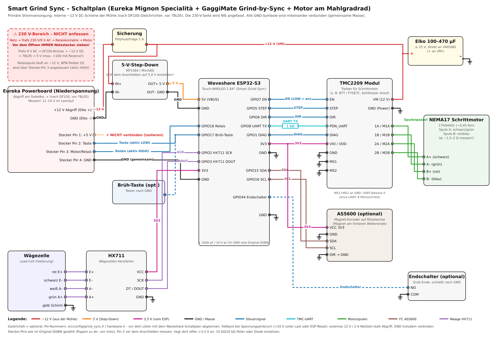
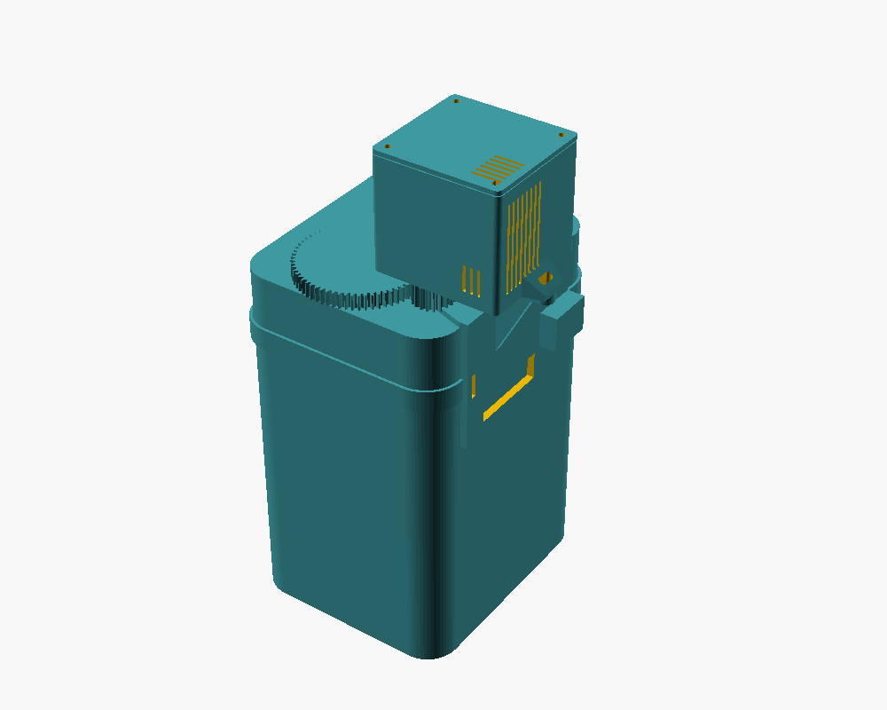

# EurekaMate – Bauanleitung für Einsteiger (Deutsch)

**EurekaMate** macht deine **Eureka Mignon Specialità** zu einer Mühle, die mit **GaggiMate** wie eine
Mahlkönig E64 WS zusammenarbeitet ("Grind-by-Sync"). Die Mühle mahlt aufs Gramm genau
(Grind-by-Weight) und meldet den Mahlvorgang an GaggiMate. Nach jedem Bezug verstellt ein
kleiner Motor das Mahlgradrad selbst: bei zu langer Bezugszeit gröber, bei zu kurzer feiner.
Zwischen Rezepten (z. B. Filter → Decaf) fährt der Motor in wenigen Sekunden um.

EurekaMate baut auf **[smart-grind-by-weight](https://github.com/jaapp/smart-grind-by-weight) von jaapp**
auf. Danke an jaapp! Lizenzen: Software GPLv3, Hardware CERN-OHL-S v2.

> ℹ️ Stand: Die Firmware kompiliert und die Logik ist mit Unit-Tests geprüft. **An einer echten
> Mühle ist sie noch nicht getestet.** Geh langsam vor und miss alles nach.

---

## 0. Sicherheit – bitte zuerst lesen ⚠️

- **Vor jedem Öffnen der Mühle: NETZSTECKER ZIEHEN.** Ausschalten reicht nicht.
- In der Mühle liegen **230 V** (Netzkabel, Trafo-Eingang, Relaiskontakte, Motor, Motorkondensator).
  **Daran wird nichts gelötet und nichts angeschlossen.** Wir arbeiten nur im Niederspannungsteil (~12 V / 5 V).
- Der Motorkondensator (8 µF) kann kurz nach dem Ziehen noch geladen sein. Nicht berühren, 2 Minuten warten.
- Messen bei eingesteckter Mühle (Abschnitt 5) **nur mit gut isolierten Messspitzen** und nur an den
  beschriebenen Niederspannungspunkten. Wenn du unsicher bist, lass dir helfen.
- Garantie: Der Umbau ist ein Eingriff in das Gerät. Alles lässt sich zurückbauen (Abschnitt 11).

---

## 1. Einkaufsliste

| # | Teil | Menge | Beispiel / Hinweis | ca. Preis |
|---|---|---|---|---|
| 1 | Waveshare **ESP32-S3-Touch-AMOLED-1.64** | 1 | Das Display von smart-grind-by-weight | 25 € |
| 2 | Wägezelle 500 g–1 kg + **HX711** | 1 | wie im SGBW-Original (siehe `docs/DOC.md`) | 8 € |
| 3 | **NEMA17-Schrittmotor 17HS4401** (normale Länge, ~0,45 Nm) | 1 | Für den optionalen AS5600: **Doppelwelle** ("dual shaft") | 10–15 € |
| 4 | **TMC2209**-Treibermodul mit Kühlkörper | 1 | BTT TMC2209 V1.3 oder FYSETC | 6 € |
| 5 | **Step-Down-Wandler 5 V** | 1 | MP1584 (einstellbar) oder Mini560 (fest 5 V) | 3 € |
| 6 | Elko **100–470 µF / 25 V** | 1 | an VM des TMC2209 | 0,50 € |
| 7 | Elko **1000 µF / 10 V** | 1 | an 5 V des ESP (wie im Original) | 0,50 € |
| 8 | Widerstand **1 kΩ** | 1 | in die UART-Leitung | 0,10 € |
| 9 | **Sicherung 1 A** (Polyfuse oder Feinsicherung + Halter) | 1 | in die 12-V-Leitung | 1 € |
| 10 | Zahnrad-Knopf-Kit für Eureka Mignon | 1 | großes Ringzahnrad + kleiner Alu-Knopf (dein Amazon-Kit) | – |
| 11 | AS5600-Platine + Diametral-Magnet 6×2,5 mm | 1 | **optional**, misst die echte Motorposition | 3 € |
| 12 | Taster (Schließer) | 1 | **optional**, Brüh-Start (alternativ Original-Fronttaste) | 1 € |
| 13 | Mikroschalter als Endschalter | 1 | **optional** | 1 € |
| 14 | Litze 22 AWG (Silikon), Dupont-/JST-PH-Stecker, Schrumpfschlauch | – | | 10 € |
| 15 | Schrauben M3: 4× 8 mm, 4× 6 mm, 2× 10 mm + Scheiben, 1× 30 mm + Mutter, 1× Madenschraube M3×4 + Mutter | – | evtl. Gewindeeinsätze M3 | 5 € |
| 16 | Filament **PETG** (Gehäuse, Halter, Ritzel), **TPU 95A** (Spannband) | – | | – |
| 17 | Optional: Netzteil **12 V / 2 A** + Hohlbuchse | 1 | **Fallback**, falls die 12-V-Schiene zu schwach ist | 10 € |

## 2. Werkzeug

- Lötkolben (≥ 60 W, feine Spitze), Lötzinn, Entlötlitze
- **Multimeter** (Gleichspannung V⎓, Widerstand Ω, Durchgang)
- Kreuz- und Innensechskantschlüssel (Mühle öffnen), kleiner Schlitzschraubendreher (Poti am MP1584)
- Seitenschneider, Abisolierzange, Schrumpfschlauch + Feuerzeug/Heißluft
- Messschieber (für die Maße der Halterung!)
- 3D-Drucker
- PC mit USB-C-Kabel, VS Code + PlatformIO **oder** Python + `pip install platformio`

---

## 3. Überblick: Was wird wie verbunden?

(Großansicht: [img/schaltplan.svg](img/schaltplan.svg))

Kurz erklärt:

- Die Mühle macht intern aus 230 V mit einem kleinen Trafo **9 V Wechselspannung**. Der Gleichrichter
  **DF10S** macht daraus **~12 V Gleichspannung**, ein **78L05** daraus 5 V für das Original-Display.
- Wir zapfen die **~12 V** an (hinter dem DF10S, vor dem 78L05). Davon versorgen wir den Motortreiber
  direkt und den ESP über den 5-V-Step-Down.
- Die **5 V aus dem Mühlenstecker (Pin 1) bleiben unbenutzt**: Der 78L05 hat weniger als 100 mA Reserve.
- Vom 4-poligen Mühlenstecker brauchen wir nur noch **GND (Pin 4)**, **Relais (Pin 3)** und **Taste (Pin 2)**.

### Verdrahtungstabelle

| Von | Nach | Farbe im Plan | Hinweis |
|---|---|---|---|
| Mühle +12 V-Abgriff (Elko +) | Sicherung 1 A → TMC2209 **VM** und → Step-Down **IN+** | rot | |
| Mühle GND (Elko −) | Step-Down **IN−**, TMC2209 **GND** (Power) | schwarz | |
| Step-Down **OUT+ (5,0 V!)** | ESP **5V** | orange | **vorher einstellen!** |
| Step-Down **OUT−** | ESP **GND** | schwarz | |
| Elko 100–470 µF | direkt an TMC2209 **VM (+) / GND (−)** | rot/schwarz | Polung beachten! |
| Elko 1000 µF | ESP **5V (+) / GND (−)** | | wie im SGBW-Original |
| Mühlenstecker **Pin 1 (+5 V)** | **nicht verbinden**, isolieren | – | |
| Mühlenstecker **Pin 2 (Taste)** | ESP **GPIO17** | blau | vorher messen (Abschnitt 5) |
| Mühlenstecker **Pin 3 (Motor/Relais)** | ESP **GPIO18** | blau | wie im Original |
| Mühlenstecker **Pin 4 (GND)** | ESP **GND** | schwarz | gemeinsame Masse |
| ESP **GPIO2** | HX711 **SCK** | lila | wie im Original |
| ESP **GPIO3** | HX711 **DT/DOUT** | lila | |
| ESP **3V3 / GND** | HX711 **VCC / GND** | | |
| ESP **GPIO7** | TMC2209 **EN** | blau | LOW = Motor an |
| ESP **GPIO5** | TMC2209 **STEP** | blau | |
| ESP **GPIO6** | TMC2209 **DIR** | blau | |
| ESP **GPIO8** → **1 kΩ** → | TMC2209 **PDN_UART** | türkis | Widerstand in die Leitung löten |
| ESP **GPIO1** | TMC2209 **DIAG** | blau | Blockiererkennung |
| ESP **3V3 / GND** | TMC2209 **VIO(VDD) / GND** | | Logikspannung |
| GND | TMC2209 **MS1** und **MS2** | | UART-Adresse 0 |
| TMC2209 **1A / 1B** | Motor **Spule A** (meist schwarz/grün) | grün | Paare messen! |
| TMC2209 **2A / 2B** | Motor **Spule B** (meist rot/blau) | grün | |
| ESP **GPIO15 / GPIO16** | AS5600 **SDA / SCL** | braun | optional |
| ESP **3V3 / GND** | AS5600 **VCC / GND**, **DIR → GND** | | optional |
| ESP **GPIO44** | Endschalter (anderes Ende an GND) | blau gestrichelt | optional |

> Die Pinbelegung steht in `src/config/grind_sync.h`. **Vor dem Löten mit dem Schaltplan des
> Waveshare-Boards vergleichen**, ob die Pins auf der Stiftleiste erreichbar und frei sind.

---

## 4. Firmware aufspielen (Flashen)

1. Repository holen: `git clone https://github.com/DobbyNator94/EurekaMate.git`
2. VS Code + Erweiterung **PlatformIO** installieren (oder `pip install platformio`).
3. Ordner öffnen. Umgebung **`waveshare-esp32s3-touch-amoled-164`** wählen.
4. Board per USB-C anschließen. **Upload** klicken bzw. `pio run -e waveshare-esp32s3-touch-amoled-164 -t upload`.
   - Wenn das Board nicht erkannt wird: **BOOT** gedrückt halten, **RESET** kurz drücken, BOOT loslassen, nochmal hochladen.
5. Nach dem Neustart erscheint der **EurekaMate-Startbildschirm** und dann die normale Waage.
6. Spätere Updates gehen **ohne Kabel** über die Weboberfläche (Reiter *Update*) oder wie im
   Original per Bluetooth (Gerätename jetzt **EurekaMate**).

Zum Ausprobieren ohne GaggiMate gibt es die Umgebung **`…-mock`**, die eine Maschine simuliert,
und `tools/mock_gaggimate.py` (falsches GaggiMate auf dem PC).

---

## 5. Messen vor dem Löten (Multimeter) 🔍

**a) Step-Down einstellen – ohne Verbraucher!**
Step-Down an ein 12-V-Netzteil (oder später an den Abgriff) hängen, Multimeter an OUT+/OUT−.
Beim MP1584 am Poti drehen, bis **5,00–5,10 V** angezeigt werden. Erst dann den ESP anschließen.

**b) Motorspulen finden (Motor nicht angeschlossen)**
Multimeter auf Ω. Die 4 Motordrähte paarweise messen: **~1,5–2 Ω = ein Spulenpaar**, offen
(OL) = verschiedene Spulen. Ein Paar an 1A/1B, das andere an 2A/2B. Dreht der Motor falsch
herum, später in der Weboberfläche *Richtung umkehren* (nicht umlöten nötig).

**c) Die 12-V-Schiene in der Mühle finden** – Netzstecker gezogen:
1. Mühle von unten öffnen (siehe SGBW-Doku), Powerboard suchen: Trafo, schwarzer
   **DF10S** (4 Beinchen, "+" und "−" markiert), Elko daneben, **78L05** (3 Beinchen, TO-92).
2. Durchgangsprüfer: DF10S "+" ↔ Elko "+" ↔ 78L05-Eingang (äußeres Bein, Datenblatt) = Durchgang
   → das ist dein **+12-V-Abgriff**. DF10S "−" / Elko "−" = **GND**.
3. Durchgang GND ↔ Mühlenstecker **Pin 4** prüfen.

**d) Spannung messen** – jetzt einstecken, **nichts anfassen**, nur Messspitzen:

| Messpunkt (schwarz an GND) | Erwartet | Wenn nicht |
|---|---|---|
| +12-V-Abgriff | **11–14 V⎓** | anderen Punkt suchen, Bild in ein Issue stellen |
| Mühlenstecker Pin 1 | ~5 V | das ist der 78L05-Ausgang – bleibt unbenutzt |
| Mühlenstecker Pin 2 (offen) | 0 V oder ≤ 3,3 V | **> 3,3 V**: Spannungsteiler 10 kΩ/20 kΩ einbauen oder Taste nicht anschließen |
| Mühlenstecker Pin 3 | ~0 V | |

Wieder **Netzstecker ziehen**.

---

## 6. Löten und Einbauen

1. **Abgriff:** zwei Litzen (rot = +12 V, schwarz = GND) an die Elko-Beinchen oder die DF10S-Pins
   auf der Lötseite anlöten. **Sicherung 1 A** in die rote Leitung. Schrumpfschlauch drüber.
   Litze innen mit Kabelbinder sichern, weg von 230-V-Teilen und vom Motor.
2. **Mühlenstecker:** wie im SGBW-Original mit JST-PH-Stecker. **Pin 1 abschneiden/isolieren**,
   Pin 2 → GPIO17, Pin 3 → GPIO18, Pin 4 → GND.
3. **Step-Down** (auf 5 V eingestellt!) und **TMC2209** im Motorgehäuse verdrahten, Elkos direkt an
   die Pins (kurze Wege!).
4. **TMC2209 Kühlkörper** aufkleben, Seite mit Kühlkörper zu den Lüftungsschlitzen.
5. Kabel (12 V, GND, Signale) gebündelt durch den Kabelausgang im Gehäuseboden nach unten zur Mühle
   führen, **Kabelbinder als Zugentlastung** durch die Schlitze.
6. Waage, HX711 und Display wie in der SGBW-Doku (`docs/DOC.md`) montieren.

## 7. Halterung drucken und montieren

Alles dazu steht in **[hardware/stepper-mount/README.md](../hardware/stepper-mount/README.md)**.
Wichtig: **erst messen, dann drucken!** Werte mit `TODO-MEASURE` in `params.scad` anpassen
(Zähnezahlen des Kits, Abstände des Knopfs, Gehäuseradius). Druck: PETG, 0,2 mm, 4 Wände.

Kurz:
1. Seitenhalter von unten an die **rechte** Seite schieben, bis der obere Arm auf der Kante liegt.
2. Spannband einmal um die ganze Mühle, vorne einhängen, hinten in den Spannschieber, mit der
   M3-Schraube festziehen (fest, aber nicht brutal).
3. Motorgehäuse auf die zwei Säulen schrauben. **Zahnspiel einstellen:** im Langloch zum Knopf
   schieben, bis die Zahnräder spielfrei greifen, minimal zurück, festziehen.
4. Mühle **aus**: das Rad einmal von Hand über den ganzen Bereich drehen. Es darf nirgends klemmen.

---

## 8. Erste Einrichtung (Assistent)

1. Einschalten. Ohne gespeichertes WLAN öffnet EurekaMate den Hotspot **`EurekaMate-Setup`**.
   Das **8-stellige Passwort** steht am Display unter *Menü → Grind Sync → Network*.
2. Mit dem Handy verbinden. Die Einrichtungsseite öffnet sich automatisch (sonst `http://192.168.4.1`).
3. Reiter **WLAN & GaggiMate** → *Netzwerke suchen* → WLAN wählen, Passwort, *Speichern*.
   Danach erreichst du die Mühle unter **http://eurekamate.local** (oder der IP am Display).
4. In **GaggiMate** (ab v1.10.0): *Einstellungen → Plugins → "Mahlkönig E64 WS Grind-by-Sync aktivieren"*.
   Dort jedem Rezeptplatz (1–6) ein Profil zuordnen. Speichern, neu starten. Im Router für GaggiMate
   eine **feste IP** reservieren.
5. Bei EurekaMate: *Suchen (mDNS)* drücken oder die GaggiMate-IP eintragen → *Verbindung testen* →
   „GaggiMate Grind-by-Sync OK“.
6. Optional ein **Web-Passwort** setzen (Benutzer `admin`).

### Motor einstellen (Reiter *Motor*)

| Einstellung | Start | Bedeutung |
|---|---|---|
| Laufstrom | 400 mA | normale Fahrt (niedrig = schont die 12-V-Schiene) |
| Boost-Strom | 600 mA | erste 400 ms jeder Fahrt (Losbrechmoment des schweren Rads) |
| Haltestrom | 0 % | Motor im Stand stromlos |
| Mikroschritte | 16 | |
| Schnell / Fein | 4000 / 800 µSchritte/s | Rezeptwechsel / GbS-Korrektur |
| StallGuard | 0 (aus) | siehe `GAGGIMATE_GBS.md` §7 zum Einstellen |

### Kalibrierung 0 / 100 (Reiter *Mahlgrad* oder Display *Dial Calibration*)

**Mühle dabei AUS lassen (nicht mahlen).**

1. *Kalibrierung starten*.
2. Mit den Tasten (±800 / ±100 / ±10 Schritte) **feiner** fahren, bis sich die Mahlscheiben **gerade berühren**
   (leises Schaben; beim Drehen von Hand fühlbar) → **„0 setzen“**.
3. Zum **gröbsten** Punkt fahren, den du je brauchst (z. B. grober Filter) → **„100 setzen“**.
4. **Sicherheitsabstand** wählen (Standard 5). Darunter fährt der Motor nie.
5. *Fertig*. Ab jetzt zeigt das Display 0–100 an, und die Position bleibt auch nach dem Ausschalten gespeichert.

### Rezepte (Reiter *Rezepte*)

| Feld | Beispiel Espresso | Beispiel Filter |
|---|---|---|
| Name | Double | Filter |
| GbS | an | aus |
| Ziel-Bezugszeit | 28 s | – |
| Getränkegewicht | 36 g (0 = Dosis × 2) | – |
| Start-Mahlgrad | 15 | 60 |
| Portionen | 1 | 3 (dreimal mahlen) |
| Trichter-Fach | keins | keins (für den späteren 4-Bohnen-Trichter vorbereitet) |

Am Display oder im Web ein Rezept antippen: Der Motor fährt mit Fortschrittsbalken und Restzeit hin.

---

### Sicherheitsverriegelungen (automatisch)

- Solange der Motor das Rad verstellt, startet die Mühle **nicht**. Ein Druck auf Start wird ignoriert; warte, bis der Balken weg ist.
- Startet das Relais trotzdem (z. B. Puls), wird der Motor vorher angehalten.
- Während die Mühle mahlt, bewegt sich das Rad nie.
- „Dosierfreigabe“ im Web-Status: Erst wenn der Mahlgrad erreicht und bestätigt ist, darf ein späterer Bohnen-Dosierer Bohnen zum Mahlwerk lassen.

## 9. Belastungstest der 12-V-Schiene (wichtig!)

Multimeter am +12-V-Abgriff lassen (gut isoliert festgeklemmt), dann:

1. Rezeptwechsel ganz fein ↔ ganz grob mehrmals (Boost-Strom) → Spannung **≥ 10 V**?
2. Einen Mahlvorgang starten → **≥ 10 V**, und das Display startet nicht neu?
3. Zeigt das Display nach einer Fahrt „Position unsicher“ (CHECK POS), war das ein Reset.

**Fällt die Spannung unter 10 V oder startet der ESP neu → Fallback:** externes **12 V / 2 A
Netzteil** an Sicherung/VM/Step-Down statt des Abgriffs. **GND trotzdem mit der Mühle verbinden.**
Den internen Abgriff dann abklemmen.

---

## 10. Fehlersuche

| Problem | Ursache / Lösung |
|---|---|
| Kein Hotspot | Es ist schon ein WLAN gespeichert → Display *Network → Setup hotspot* |
| „GaggiMate not found“ | Plugin aktiviert? Gleiches 2,4-GHz-Netz? IP statt `gaggimate.local` eintragen |
| „no Grind-by-Sync endpoint“ | GaggiMate < v1.10.0 oder Plugin aus → aktivieren, neu starten |
| Motor brummt, dreht nicht | Spulenpaare falsch → nachmessen. Strom zu klein → Boost erhöhen |
| Motor dreht falsch herum | *Motor → Richtung umkehren*, dann neu kalibrieren |
| Motor stoppt mit „Stall“ | StallGuard zu empfindlich → Wert senken oder 0 |
| Rad zu schwer | Boost-Strom erhöhen, kleineres Ritzel (10 Z), Getriebemotor 5:1 (`GAGGIMATE_GBS.md` §7) |
| Mahlgrad wird nicht korrigiert | Rezept hat GbS aus, „Auto“ aus, Bezug < 15 s oder > Ziel + 15 s, abgebrochen, Gewicht > 25 % daneben → Verlauf zeigt den Grund |
| TMC wird heiß | Kühlkörper, Laufstrom senken, Haltestrom 0 % |

## 11. Zurückbauen

Abgriff ablöten, Original-Display und Stecker wieder einstecken (wie im SGBW-Original),
Halterung abschrauben, Spannband lösen. Es wurde nichts gebohrt.
