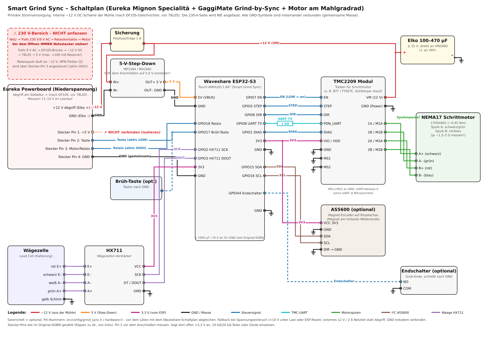
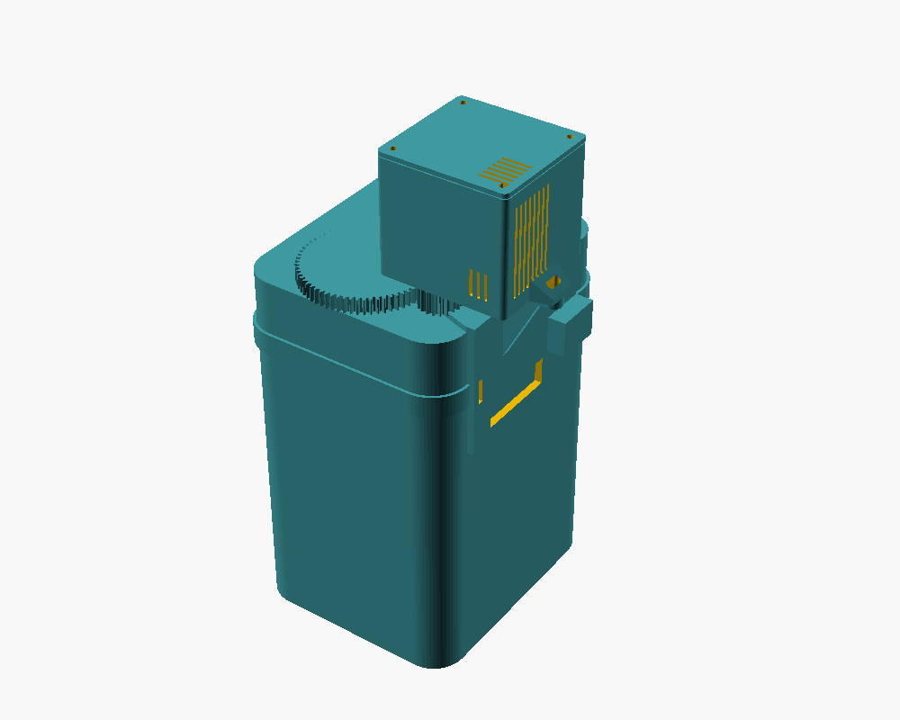

# EurekaMate – Beginner build guide (English)

> [!CAUTION]
> **🇩🇪 ACHTUNG – BITTE ZUERST LESEN:** Dieses Projekt ist **komplett „vibe-coded“ (KI-generiert)** und
> **komplett ungetestet** – weder die Firmware noch die Hardware, die Pläne oder die Anleitungen wurden an einer
> echten Mühle ausprobiert. Es gibt **keinerlei Garantie, Gewährleistung oder Haftung für irgendetwas**.
> **Jeder ist allein für sich selbst verantwortlich.** Arbeiten an **230-V-Geräten ist gefährlich** und kann
> tödlich sein. **Wenn du nicht genau weißt, was du tust, lass es lieber ganz bleiben.**
>
> **🇬🇧 WARNING – READ THIS FIRST:** This project is **entirely vibe-coded (AI-generated)** and **completely
> untested** – none of the firmware, hardware, schematics or guides have been tried on a real grinder. There is
> **no guarantee, warranty or liability for anything whatsoever**. **Everyone is solely responsible for
> themselves.** Working on **230 V devices is dangerous** and can kill you. **If you don't know exactly what
> you're doing, better don't do anything at all.**

🇩🇪 Deutsche Version: **[ANLEITUNG_DE.md](ANLEITUNG_DE.md)** ·
🧸 Very simple step-by-step version with images: **[BUILD_GUIDE_EN.md](BUILD_GUIDE_EN.md)** ·
⚡ **[Web flasher](https://dobbynator94.github.io/EurekaMate/)**

**EurekaMate** turns your **Eureka Mignon Specialità** into a grinder that works with **GaggiMate** like a
Mahlkönig E64 WS ("Grind-by-Sync"). The grinder grinds to the gram (grind-by-weight) and reports each
grind to GaggiMate. After every shot a small motor turns the grind dial by itself: coarser if the shot
ran too long, finer if it was too short. Between recipes (e.g. Filter → Decaf) the motor moves the dial in a few seconds.

EurekaMate is built on **[smart-grind-by-weight](https://github.com/jaapp/smart-grind-by-weight) by jaapp**.
Thanks, jaapp! Licences: software GPLv3, hardware CERN-OHL-S v2.

> ℹ️ Status: the firmware builds and the logic has unit tests. **It has not been tested on a real
> grinder yet.** Go slowly and measure everything.

---

## 0. Safety – read this first ⚠️

- **Before opening the grinder, every time: PULL THE MAINS PLUG.** Switching off is not enough.
- The grinder contains **230 V** (mains cable, transformer input, relay contacts, motor, motor capacitor).
  **Nothing is soldered to or connected there.** We only work on the low-voltage side (~12 V / 5 V).
- The motor capacitor (8 µF) can still be charged right after unplugging. Don't touch it; wait 2 minutes.
- Measuring with the grinder plugged in (section 5) **only with well-insulated probes** and only at the
  low-voltage points described. If you are unsure, get help.
- Warranty: the conversion is a modification of the appliance. Everything can be reverted (section 11).

---

## 1. Shopping list

| # | Part | Qty | Example / note | approx. price |
|---|---|---|---|---|
| 1 | Waveshare **ESP32-S3-Touch-AMOLED-1.64** | 1 | The display from smart-grind-by-weight | €25 |
| 2 | Load cell 500 g–1 kg + **HX711** | 1 | as in the SGBW original (see `docs/DOC.md`) | €8 |
| 3 | **NEMA17 stepper 17HS4401** (standard length, ~0.45 Nm) | 1 | For the optional AS5600: **dual shaft** | €10–15 |
| 4 | **TMC2209** driver module with heatsink | 1 | BTT TMC2209 V1.3 or FYSETC | €6 |
| 5 | **5 V buck converter** | 1 | MP1584 (adjustable) or Mini560 (fixed 5 V) | €3 |
| 6 | Capacitor **100–470 µF / 25 V** | 1 | on the TMC2209 VM | €0.50 |
| 7 | Capacitor **1000 µF / 10 V** | 1 | on the ESP 5 V (as in the original) | €0.50 |
| 8 | Resistor **1 kΩ** | 1 | in the UART line | €0.10 |
| 9 | **1 A fuse** (polyfuse or glass fuse + holder) | 1 | in the 12 V line | €1 |
| 10 | Gear knob kit for Eureka Mignon | 1 | big ring gear + small aluminium knob (your Amazon kit) | – |
| 11 | AS5600 board + diametric magnet 6×2.5 mm | 1 | **optional**, measures the real motor position | €3 |
| 12 | Push button (normally open) | 1 | **optional**, brew start (or the original front button) | €1 |
| 13 | Micro switch as endstop | 1 | **optional** | €1 |
| 14 | 22 AWG silicone wire, Dupont/JST-PH plugs, heat shrink | – | | €10 |
| 15 | M3 screws: 4× 8 mm, 4× 6 mm, 2× 10 mm + washers, 1× 30 mm + nut, 1× M3×4 grub screw + nut | – | heat inserts M3 if you like | €5 |
| 16 | Filament **PETG** (housing, brace, pinion), **TPU 95A** (strap) | – | | – |
| 17 | Optional: **12 V / 2 A** power supply + barrel jack | 1 | **fallback** if the 12 V rail is too weak | €10 |

## 2. Tools

- Soldering iron (≥ 60 W, fine tip), solder, desoldering braid
- **Multimeter** (DC voltage V⎓, resistance Ω, continuity)
- Phillips and hex keys (to open the grinder), small flat screwdriver (trimmer on the MP1584)
- Side cutters, wire stripper, heat shrink + lighter/heat gun
- Calipers (for the mount dimensions!)
- 3D printer
- PC with Chrome/Edge and a USB-C data cable (web flasher). For developers: VS Code + PlatformIO **or** Python + `pip install platformio`

---

## 3. Overview: what connects to what?

(Full size: [img/schaltplan.svg](img/schaltplan.svg))

In short:

- Inside, the grinder makes **9 V AC** from 230 V with a small transformer. The **DF10S** rectifier turns
  that into **~12 V DC**, and a **78L05** makes 5 V for the original display.
- We tap the **~12 V** (after the DF10S, before the 78L05). It feeds the motor driver directly and the ESP
  through the 5 V buck converter.
- The **5 V from the grinder harness (pin 1) stays unused**: the 78L05 has less than 100 mA to spare.
- From the 4-pin grinder harness we only use **GND (pin 4)**, **relay (pin 3)** and **button (pin 2)**.

### Wiring table

| From | To | Colour in the plan | Note |
|---|---|---|---|
| Grinder +12 V tap (capacitor +) | 1 A fuse → TMC2209 **VM** and → buck **IN+** | red | |
| Grinder GND (capacitor −) | buck **IN−**, TMC2209 **GND** (power) | black | |
| Buck **OUT+ (5.0 V!)** | ESP **5V** | orange | **set it first!** |
| Buck **OUT−** | ESP **GND** | black | |
| Capacitor 100–470 µF | directly on TMC2209 **VM (+) / GND (−)** | red/black | mind the polarity! |
| Capacitor 1000 µF | ESP **5V (+) / GND (−)** | | as in the SGBW original |
| Harness **pin 1 (+5 V)** | **do not connect**, insulate | – | |
| Harness **pin 2 (button)** | ESP **GPIO17** | blue | measure first (section 5) |
| Harness **pin 3 (motor/relay)** | ESP **GPIO18** | blue | as in the original |
| Harness **pin 4 (GND)** | ESP **GND** | black | common ground |
| ESP **GPIO2** | HX711 **SCK** | purple | as in the original |
| ESP **GPIO3** | HX711 **DT/DOUT** | purple | |
| ESP **3V3 / GND** | HX711 **VCC / GND** | | |
| ESP **GPIO7** | TMC2209 **EN** | blue | LOW = motor on |
| ESP **GPIO5** | TMC2209 **STEP** | blue | |
| ESP **GPIO6** | TMC2209 **DIR** | blue | |
| ESP **GPIO8** → **1 kΩ** → | TMC2209 **PDN_UART** | teal | solder the resistor into the line |
| ESP **GPIO1** | TMC2209 **DIAG** | blue | stall detection |
| ESP **3V3 / GND** | TMC2209 **VIO(VDD) / GND** | | logic supply |
| GND | TMC2209 **MS1** and **MS2** | | UART address 0 |
| TMC2209 **1A / 1B** | motor **coil A** (usually black/green) | green | measure the pairs! |
| TMC2209 **2A / 2B** | motor **coil B** (usually red/blue) | green | |
| ESP **GPIO15 / GPIO16** | AS5600 **SDA / SCL** | brown | optional |
| ESP **3V3 / GND** | AS5600 **VCC / GND**, **DIR → GND** | | optional |
| ESP **GPIO44** | endstop (other end to GND) | blue dashed | optional |

> The pin map lives in `src/config/grind_sync.h`. **Before soldering, check against the Waveshare board
> schematic** that the pins are reachable on the header and free.

---

## 4. Installing the firmware (flashing)

### Easy: web flasher (recommended)

1. Connect the board to the PC with a **USB-C data cable**. The grinder stays **unplugged**.
2. Open in **Chrome or Edge (desktop)**: **https://dobbynator94.github.io/EurekaMate/**
3. Choose **v0.1.0-beta** → **“Install”** → pick the port → first time: tick **“Erase device”** → *Install*.
4. Wait 1–2 minutes. The **EurekaMate splash screen** appears.
   - No port? Hold **BOOT**, tap **RESET**, release BOOT, try again.

Detailed, with images and troubleshooting: **[BUILD_GUIDE_EN.md, step 8](BUILD_GUIDE_EN.md#8-flash-the-firmware-with-the-web-flasher)**.
The files are also in [release v0.1.0-beta](https://github.com/DobbyNator94/EurekaMate/releases/tag/v0.1.0-beta).

### For developers: build it yourself with PlatformIO

1. Get the repository: `git clone https://github.com/DobbyNator94/EurekaMate.git`
2. Install VS Code + the **PlatformIO** extension (or `pip install platformio`).
3. Open the folder. Choose the **`waveshare-esp32s3-touch-amoled-164`** environment.
4. Connect the board via USB-C. Click **Upload** or run `pio run -e waveshare-esp32s3-touch-amoled-164 -t upload`.
   - If the board isn't detected: hold **BOOT**, tap **RESET**, release BOOT, upload again.
5. After the reboot, the **EurekaMate splash screen** appears, then the normal scale.
6. Later updates work **without a cable** via the web UI (*Update* tab) or via Bluetooth in the
   [web flasher](https://dobbynator94.github.io/EurekaMate/) (*Update (Bluetooth)* tab, device name **EurekaMate**).

For trying it without GaggiMate there is the **`…-mock`** environment, which simulates a machine,
and `tools/mock_gaggimate.py` (a fake GaggiMate on your PC).

---

## 5. Measure before soldering (multimeter) 🔍

**a) Set the buck converter – with no load!**
Connect the buck to a 12 V supply (or later to the tap), multimeter on OUT+/OUT−.
On the MP1584, turn the trimmer until it reads **5.00–5.10 V**. Only then connect the ESP.

**b) Find the motor coils (motor not connected)**
Multimeter on Ω. Measure the 4 motor wires in pairs: **~1.5–2 Ω = one coil pair**, open (OL) = different
coils. One pair to 1A/1B, the other to 2A/2B. If the motor turns the wrong way, use *Reverse direction*
in the web UI later (no re-soldering needed).

**c) Find the 12 V rail in the grinder** – mains plug pulled:
1. Open the grinder from below (see the SGBW docs) and find the power board: transformer, black
   **DF10S** (4 legs, "+" and "−" marked), capacitor next to it, **78L05** (3 legs, TO-92).
2. Continuity tester: DF10S "+" ↔ capacitor "+" ↔ 78L05 input (outer leg, see datasheet) = continuity
   → that is your **+12 V tap**. DF10S "−" / capacitor "−" = **GND**.
3. Check continuity GND ↔ harness **pin 4**.

**d) Measure voltages** – now plug in, **touch nothing**, probes only:

| Measuring point (black on GND) | Expected | If not |
|---|---|---|
| +12 V tap | **11–14 V⎓** | look for another point, post a photo in an issue |
| Harness pin 1 | ~5 V | that's the 78L05 output – stays unused |
| Harness pin 2 (open) | 0 V or ≤ 3.3 V | **> 3.3 V**: add a 10 kΩ/20 kΩ voltage divider or don't connect the button |
| Harness pin 3 | ~0 V | |

**Pull the mains plug** again.

---

## 6. Soldering and installation

1. **Tap:** solder two wires (red = +12 V, black = GND) to the capacitor legs or the DF10S pins on the
   solder side. **1 A fuse** in the red wire. Heat shrink over it. Secure the wire inside with a zip tie,
   away from 230 V parts and the motor.
2. **Grinder harness:** as in the SGBW original with a JST-PH plug. **Cut/insulate pin 1**,
   pin 2 → GPIO17, pin 3 → GPIO18, pin 4 → GND.
3. Wire the **buck** (set to 5 V!) and the **TMC2209** inside the motor housing, capacitors directly on the
   pins (short leads!).
4. Stick the **TMC2209 heatsink** on, heatsink side toward the vent slots.
5. Route the bundled cables (12 V, GND, signals) through the cable exit in the housing floor down to the
   grinder, with **zip ties as strain relief** through the slots.
6. Mount the scale, HX711 and display as in the SGBW docs (`docs/DOC.md`).

## 7. Print and mount the bracket

Everything is in **[hardware/stepper-mount/README.md](../hardware/stepper-mount/README.md)**,
with images from several angles and an exploded view in **[BUILD_GUIDE_EN.md, step 7](BUILD_GUIDE_EN.md#7-mount-the-bracket)**.
Important: **measure first, then print!** Adjust the `TODO-MEASURE` values in `params.scad`
(kit tooth counts, knob position, body radius). Print: PETG, 0.2 mm, 4 walls.

In short:
1. Slide the side brace on from below along the **right** side until the top arm rests on the edge.
2. Put the strap once around the whole grinder, hook it in at the front, into the tension slider at the
   back, and tighten with the M3 screw (firm, not brutal).
3. Screw the motor housing onto the two posts. **Set the gear mesh:** slide it along the slots toward the
   knob until the gears mesh without play, back off a hair, tighten.
4. Grinder **off**: turn the dial by hand once over the full range. It must not bind anywhere.

---

## 8. First setup (wizard)

1. Switch on. With no WiFi stored, EurekaMate opens the **`EurekaMate-Setup`** hotspot.
   The **8-digit password** is on the display under *Menu → Grind Sync → Network*.
2. Connect with your phone. The setup page opens automatically (otherwise `http://192.168.4.1`).
3. Tab **WLAN & GaggiMate** → *scan networks* → choose WiFi, password, *save*.
   After that, the grinder is at **http://eurekamate.local** (or the IP on the display).
4. In **GaggiMate** (v1.10.0+): *Settings → Plugins → "Enable Mahlkönig E64 WS Grind-by-Sync"*.
   Assign a profile to each recipe slot (1–6). Save, restart. Reserve a **fixed IP** for GaggiMate in your router.
5. In EurekaMate: press *Search (mDNS)* or enter the GaggiMate IP → *Test connection* →
   "GaggiMate Grind-by-Sync OK".
6. Optionally set a **web password** (user `admin`).

### Motor settings (*Motor* tab)

| Setting | Start | Meaning |
|---|---|---|
| Run current | 400 mA | normal travel (low = easier on the 12 V rail) |
| Boost current | 600 mA | first 400 ms of each move (breakaway torque of the heavy dial) |
| Hold current | 0 % | motor unpowered at rest |
| Microsteps | 16 | |
| Fast / fine | 4000 / 800 µsteps/s | recipe change / GbS correction |
| StallGuard | 0 (off) | see `GAGGIMATE_GBS.md` §7 for tuning |

### Calibration 0 / 100 (*Mahlgrad* tab or display *Dial Calibration*)

**Keep the grinder OFF (don't grind).**

1. *Start calibration*.
2. Use the buttons (±800 / ±100 / ±10 steps) to go **finer** until the burrs **just touch**
   (faint scraping; you can feel it turning by hand) → **"set 0"**.
3. Go to the **coarsest** point you will ever need (e.g. coarse filter) → **"set 100"**.
4. Choose a **safety margin** (default 5). The motor never goes below it.
5. *Done*. The display now shows 0–100, and the position is kept after power-off.

### Recipes (*Rezepte* tab)

| Field | Espresso example | Filter example |
|---|---|---|
| Name | Double | Filter |
| GbS | on | off |
| Target shot time | 28 s | – |
| Beverage weight | 36 g (0 = dose × 2) | – |
| Start grind setting | 15 | 60 |
| Portions | 1 | 3 (grind three times) |
| Hopper slot | none | none (prepared for the future 4-bean hopper) |

Tap a recipe on the display or in the web UI: the motor moves there with a progress bar and remaining time.

---

### Safety interlocks (automatic)

- While the motor is moving the dial, the grinder does **not** start. A press on start is ignored; wait until the bar is gone.
- If the relay starts anyway (e.g. a pulse), the motor is stopped first.
- While the grinder is running, the dial never moves.
- "Dose allowed" in the web status: only when the grind setting is reached and confirmed may a future bean doser release beans to the burrs.

## 9. 12 V rail load test (important!)

Leave the multimeter on the +12 V tap (clamped, well insulated), then:

1. Change recipes very fine ↔ very coarse several times (boost current) → voltage **≥ 10 V**?
2. Start a grind → **≥ 10 V**, and the display does not reboot?
3. If the display shows "position uncertain" (CHECK POS) after a move, that was a reset.

**If the voltage drops below 10 V or the ESP reboots → fallback:** an external **12 V / 2 A power supply**
on fuse/VM/buck instead of the tap. **Still connect GND to the grinder.** Disconnect the internal tap.

---

## 10. Troubleshooting

| Problem | Cause / fix |
|---|---|
| No hotspot | A WiFi is already stored → display *Network → Setup hotspot* |
| "GaggiMate not found" | Plugin enabled? Same 2.4 GHz network? Enter the IP instead of `gaggimate.local` |
| "no Grind-by-Sync endpoint" | GaggiMate < v1.10.0 or plugin off → enable, restart |
| Motor hums, doesn't turn | Wrong coil pairs → measure again. Current too low → raise boost |
| Motor turns the wrong way | *Motor → Reverse direction*, then recalibrate |
| Motor stops with "Stall" | StallGuard too sensitive → lower the value or 0 |
| Dial too stiff | Raise boost current, smaller pinion (10 T), 5:1 geared motor (`GAGGIMATE_GBS.md` §7) |
| Grind not corrected | Recipe has GbS off, "Auto" off, shot < 15 s or > target + 15 s, aborted, weight > 25 % off → history shows the reason |
| TMC gets hot | Heatsink, lower run current, hold current 0 % |

## 11. Reverting

Desolder the tap, plug the original display and harness back in (as in the SGBW original),
unscrew the bracket, loosen the strap. Nothing was drilled.
