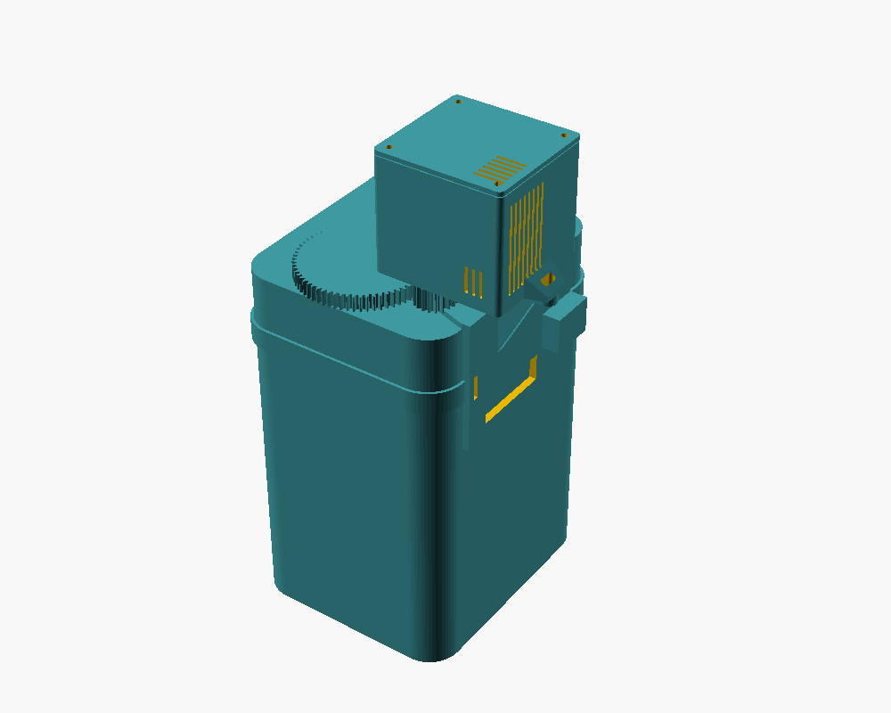
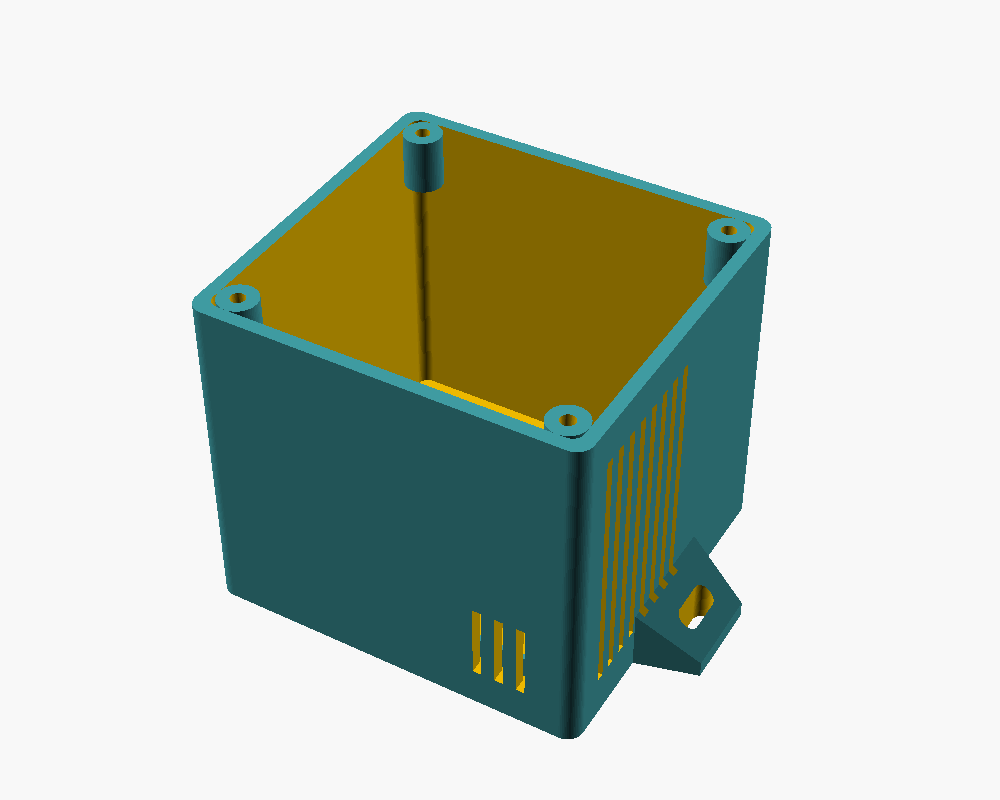
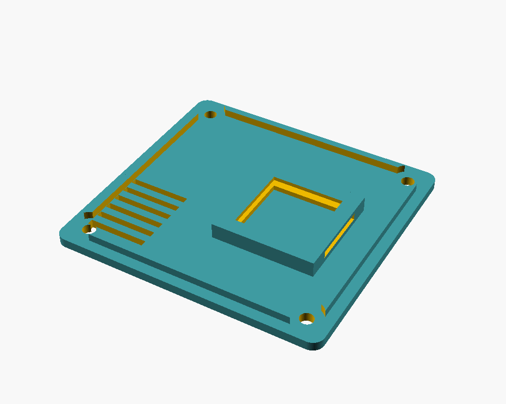
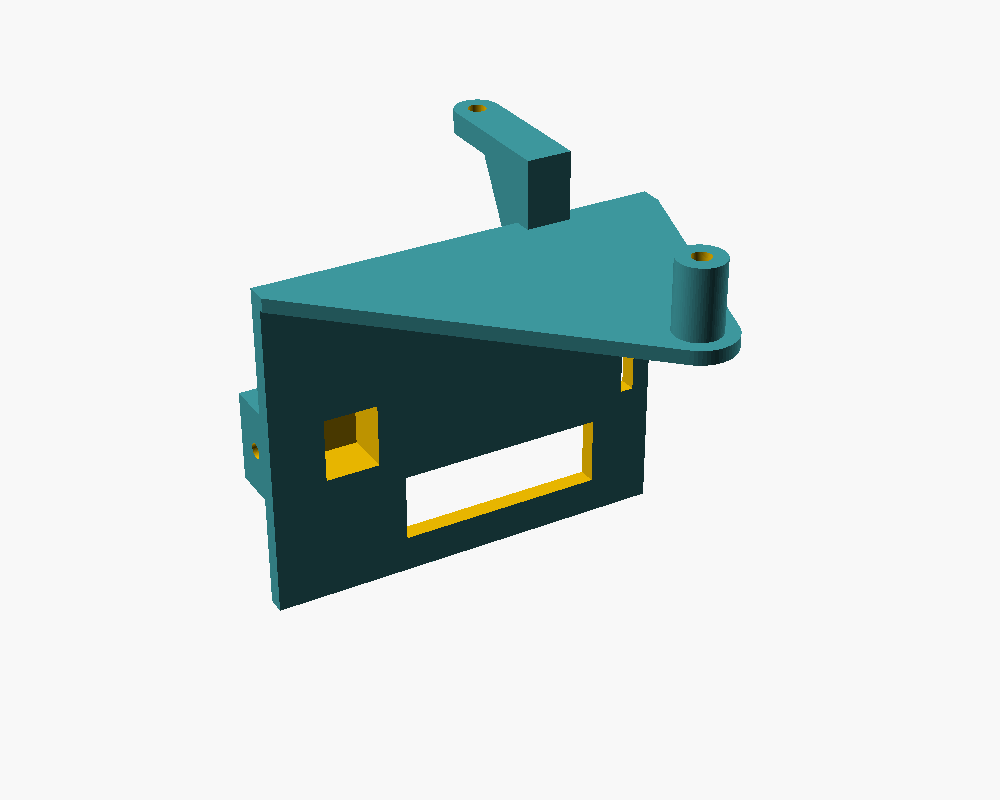
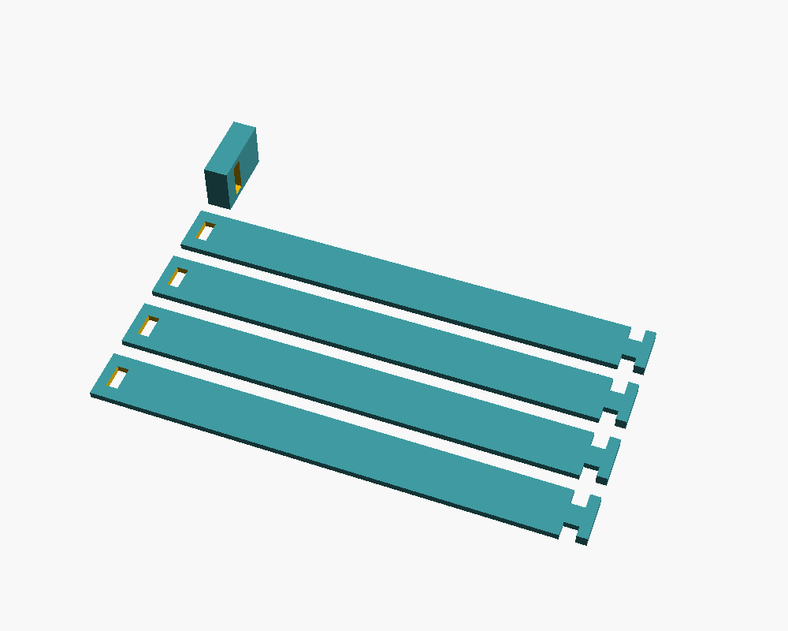
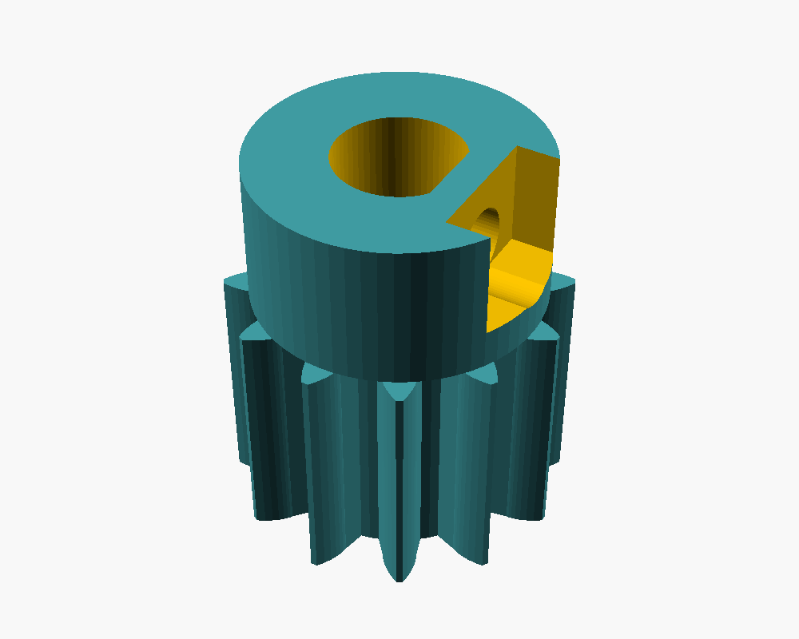

# Motor mount for the Eureka Mignon Specialità (no drilling)

Parametric OpenSCAD design for the EurekaMate dial drive. It is built around the
aftermarket **gear-knob kit**: a big ring gear on the grind dial and a small aluminium knob
gear. A NEMA17 stepper turns the small knob gear through a printed pinion.

| Part | STL | Preview | Qty | Notes |
|---|---|---|---|---|
| Motor + electronics housing | `stl/motor_housing.stl` |  | 1 | Holds the NEMA17 (shaft down), TMC2209 + heatsink, 5 V buck and bulk cap. Vent slots, cable exit to the bottom with zip-tie strain relief, slotted feet to set the gear mesh |
| Housing lid | `stl/housing_lid.stl` |  | 1 | 4× M3. Has the optional AS5600 holder on the pinion axis (reads the rear shaft magnet) |
| Side brace | `stl/side_brace.stl` |  | 1 | Slides on from **below** along the **right** body side until the top arm hooks over the top edge. Carries the housing on two M3 posts |
| Strap segment | `stl/strap_segment.stl` |  | 4 | Closed band around the whole body. Segments link with a T-hook. TPU 95A is best; PETG works (set `strap_t = 1.2`) |
| Strap tension slider | `stl/strap_tension_slider.stl` | (in strap preview) | 1 | Runs in the rear rail of the brace. An M3 screw pulls it backwards to tension the band |
| Drive pinion | `stl/pinion.stl` |  | 1 | 5 mm D-shaft, M3 grub screw + nut trap. Default 12 T, module 1.0, 20° |
| Magnet cap (optional) | `stl/magnet_cap.stl` | – | 1 | Only for a dual-shaft motor + AS5600. Press it on the rear shaft and glue in a 6×2.5 mm diametric magnet |

Front view: [preview/assembly_front.png](preview/assembly_front.png).

Re-export everything with `./export.sh` (needs `openscad`; `xvfb-run` on a headless PC).
All dimensions are in `scad/params.scad`.

## ⚠️ Check before you print

The defaults come from public data (see Sources) plus best guesses for the kit. **Every value
marked `TODO-MEASURE` in `params.scad` must be measured on your grinder and kit.** The most
important ones:

| Parameter | What to measure | How |
|---|---|---|
| `kit_small_teeth`, `kit_ring_teeth` | Teeth on the small knob gear and on the big ring | Count them. Mark one tooth with a pen |
| `kit_gear_module` | Gear module | Tip diameter ÷ (teeth + 2). Example: 22 mm tip on a 20 T gear gives module 1.0. Common values are 0.8, 1.0 and 1.25 |
| `knob_from_right`, `knob_from_front` | Where the small knob axis sits | Measure from the knob centre to the right body wall and to the front face, with a ruler held flat against the body |
| `knob_top_above_body`, `kit_knob_height` | Knob top above the body top; tooth width | Caliper |
| `body_d`, `body_r`, `body_top_z` | Body depth at strap height, corner radius, top height | Caliper/ruler. For the radius, hold a coin or cup against the corner and compare |
| `strap_z` | Strap height below the top | Choose a height where the band does not cover the display, the button or the spout |
| `motor_len`, `rear_shaft_len` | Motor body length; rear shaft length on a dual-shaft motor | Caliper |

Then:

1. Print **only the pinion** first. Check the D-bore fit and the mesh with the knob gear: no
   binding, but almost no play.
2. Print the side brace. Slide it on and check the top arm against the dial, hopper and display.
3. Print the housing, then the lid, then the strap.

## Print settings

| Setting | Value |
|---|---|
| Material | **PETG** (housing, lid, brace, pinion). Strap: **TPU 95A**, or PETG with `strap_t = 1.2` |
| Layer height | 0.2 mm (pinion: 0.12–0.16 mm gives better teeth) |
| Walls | 4 perimeters |
| Infill | 30–40 % gyroid (pinion: 100 %) |
| Supports | Housing: none (feet chamfered). Brace: upright as exported, tree supports under the top arm and the outer shelf. Lid: print flat face down (STL is already flipped) |
| Orientation | Pinion with the teeth down. Strap flat |

Hardware: M3×8 (4×, motor), M3×6 (4×, lid), M3×10 + washers (2×, housing feet to brace posts;
use heat inserts M3×4×5 for 4.2 mm holes or self-tap 2.6 mm), M3×30 + M3 nut (tensioner),
M3×4 grub screw + nut (pinion), zip ties 2.5 mm.

## Assembly

1. Fit the motor into the housing, shaft down through the floor. Screw it in with 4× M3×8 from below.
2. Push the pinion onto the shaft with the grub screw on the D-flat. Line its teeth up with the height of the knob gear teeth, then tighten.
3. Put the TMC2209 (heatsink toward the side vents), the buck and the capacitor in their spots. Wire them per [`../../docs/img/schaltplan.png`](../../docs/img/schaltplan.png).
4. Slide the brace on from below along the right side until the arm sits on the top edge.
5. Thread the strap through the front slot of the brace, run it around the body and hook it into the tension slider. Tighten the M3 screw until the brace no longer moves. Do not over-tighten: PETG creeps.
6. Set the housing on the posts with 2× M3×10 + washers. **Mesh adjustment:** push the housing along the slots toward the knob until the gears mesh with no play. Back off a hair (paper-thickness test) and tighten.
7. Turn the dial by hand once over the full range: it must not bind anywhere.
8. Optional AS5600: dual-shaft motor + magnet cap on the rear shaft. Slide the AS5600 board, chip down, into the lid holder. Chip-to-magnet gap is 0.5–3 mm (`as5600_gap`).

## Sources for the dimensions

- Eureka product page, Mignon Specialità: H 350 / W 120 / D 140 mm, 5.6 kg — https://eureka.co.it/en/products/eureka+1920/prosumer+grinders/silent+range/20/
- Eureka datasheet "Mignon Specialità" (2020): same values — https://www.eureka.co.it/public/files/catalogo/20/Mignon_Specialita.pdf
- Eureka Mignon Silent user manual (2018): W 120, **D 180** (includes the portafilter fork), H 350 — https://www.eureka.co.it/public/files/catalogo/21/mignon%20silent%20user%20manual%20(it-en-de)%20-%20M24_01_03-2018.pdf
- smart-grind-by-weight CAD (`3d_files/Back plate.stl`, Fusion source `.f3z`): the back plate spans 126 mm across the body (120 mm body + walls). Use the `.f3z` for exact body contours.
- Community Mignon mounts (for shape reference): MakerWorld "Grinder Scale Eureka Mignon Mod" https://makerworld.com/en/models/2027665 and Printables 1514218 (see `docs/3D_PRINTS.md`).

The gear-knob kit has no public datasheet. Tooth counts, module and positions **must** be
measured; the defaults are placeholders.

## Torque and reduction (short version)

Total reduction `i = (kit_small_teeth / pinion_teeth) × (kit_ring_teeth / kit_small_teeth)`.
With the defaults (12 → 20 → 66): i = 5.5. For the full calculation, the fallbacks (10 T
pinion, NEMA17 with a 5:1 planetary gearbox) and travel times, see
[`docs/GAGGIMATE_GBS.md`](../../docs/GAGGIMATE_GBS.md#torque-estimate).

## License

Hardware design: CERN-OHL-S v2, like the rest of the smart-grind-by-weight hardware.
